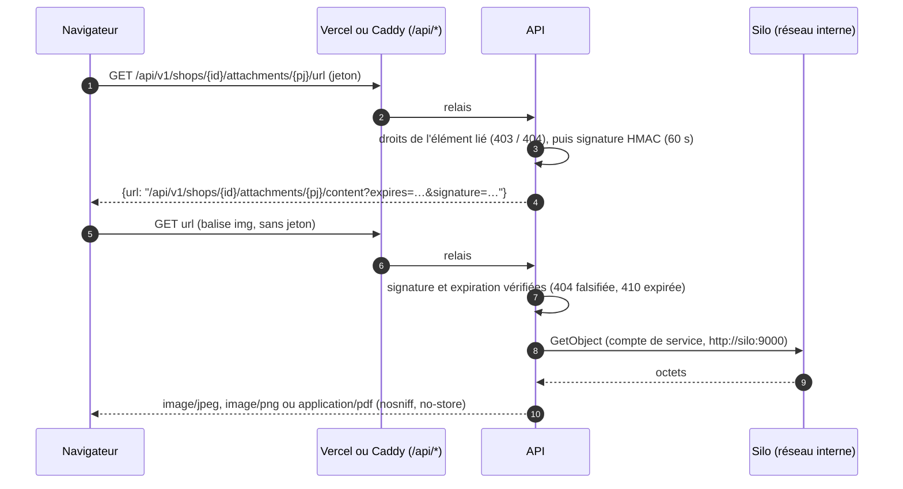

# Déploiement en production (T25)

Ce document explique, pas à pas, comment mettre l'application en ligne sur le VPS avec
**Portainer**, puis le frontend sur **Vercel**. Références : `specs.md` § 4.7 (déploiement),
§ 7.3 (cache), § 9.2 (sauvegardes).

## 1. Ce qui tourne sur le VPS

Une **seule stack** Portainer, décrite par `infra/docker-compose.prod.yml` :

| Service | Rôle | Exposé sur Internet ? |
| --- | --- | --- |
| `caddy` | HTTPS automatique (Let's Encrypt), sert l'application web, relaie `/api` vers l'API | **oui**, ports 80 et 443 |
| `api` | l'API (FastAPI). Au démarrage : applique les migrations, vérifie la base, puis sert | non |
| `postgres` | la base de données (PostgreSQL 18.6) | non |
| `silo` | le stockage des fichiers (compatible S3, bucket privé) | non |
| `silo-init` | crée le bucket privé et le compte de service de l'API, puis s'arrête (« Exited (0) » normal) | non |
| `backup` | sauvegarde de la base au démarrage puis chaque nuit, garde 30 copies | non |

Les données sont dans des **volumes nommés** (`pg_data`, `silo_data`, `backups`, `caddy_data`,
`caddy_config`) : mettre à jour ou redéployer la stack ne les efface pas.
Seul **supprimer les volumes** efface les données : ne jamais cocher « supprimer les volumes ».

Adresse provisoire : `https://api.169-58-70-37.sslip.io` (nom gratuit dérivé de l'IP du VPS,
ce qui permet un vrai certificat HTTPS). Cette adresse sert l'application **et** l'API.

## 2. Avant le premier déploiement

1. **Ports** : sur le VPS, les ports **80/tcp**, **443/tcp** et **443/udp** doivent être ouverts
   dans le pare-feu et **libres** (aucun autre serveur web dessus).
2. **Sous-réseau** : choisir un sous-réseau privé libre pour le réseau interne
   (proposition : `172.30.57.0/24`). Vérifier dans Portainer → Networks qu'aucun réseau ne
   l'utilise déjà.
3. **Secrets** : générer trois secrets (lettres, chiffres, `-` et `_` seulement) :

   ```bash
   python -c "import secrets; print(secrets.token_urlsafe(48))"
   ```

   un pour `POSTGRES_PASSWORD`, un pour `JWT_SECRET`, un pour `S3_ROOT_PASSWORD`, un pour
   `S3_API_SECRET_KEY` (quatre au total).
   Les ranger dans le gestionnaire de mots de passe de l'équipe. **Jamais dans git.**

## 3. Créer la stack dans Portainer

1. Portainer → **Stacks** → **Add stack**.
2. Nom : `boutique` (le nom de la stack préfixe les conteneurs et les volumes ; ne plus le changer).
3. Méthode : **Repository**.
   - Repository URL : l'adresse du dépôt Git public.
   - Repository reference : `refs/heads/main`.
   - Compose path : `infra/docker-compose.prod.yml`.
4. **Environment variables** : ajouter une ligne par variable (modèle : `infra/.env.prod.example`).

   | Variable | Obligatoire | Rôle |
   | --- | --- | --- |
   | `API_PUBLIC_HOST` | oui | nom public servi par Caddy : `api.169-58-70-37.sslip.io` |
   | `ACME_EMAIL` | oui | adresse de contact pour Let's Encrypt |
   | `POSTGRES_USER` | oui | utilisateur de la base (ex. `boutique`) |
   | `POSTGRES_PASSWORD` | oui | mot de passe de la base (secret) |
   | `POSTGRES_DB` | oui | nom de la base (ex. `boutique`) |
   | `JWT_SECRET` | oui | signature des jetons de connexion, 32 caractères au moins (secret) |
   | `INTERNAL_SUBNET` | oui | sous-réseau du réseau interne (ex. `172.30.57.0/24`) |
   | `S3_ROOT_USER` | oui | identifiant du stockage de fichiers |
   | `S3_ROOT_PASSWORD` | oui | mot de passe du stockage de fichiers, 8 caractères au moins (secret) |
   | `S3_BUCKET` | oui | nom du bucket des pièces jointes (ex. `attachments`) |
   | `S3_API_ACCESS_KEY` | oui | identifiant du compte de service de l'API dans Silo (ex. `boutique-api`), différent de `S3_ROOT_USER` |
   | `S3_API_SECRET_KEY` | oui | secret de ce compte, 8 caractères au moins (secret) |
   | `ATTACHMENT_LINK_TTL_SECONDS` | non | durée des liens vers les pièces jointes (`60` s par défaut) |
   | `LOG_LEVEL` | non | niveau des journaux (`INFO` par défaut) |
   | `API_WORKERS` | non | nombre de processus de l'API (`1` par défaut) |
   | `BACKUP_KEEP` | non | nombre de sauvegardes gardées (`30` par défaut) |
   | `BACKUP_TIME_UTC` | non | heure de la sauvegarde de nuit, en UTC (`01:30` = 02:30 à Douala) |
   | `APP_VERSION` | non | version affichée dans l'application (sinon : version + date du build) |

   Une variable obligatoire oubliée fait **échouer le déploiement** avec un message
   « … manquant » : rien ne démarre à moitié.
5. Cliquer **Deploy the stack**. La première fois, Portainer construit les images (API,
   Caddy avec l'application web, sauvegarde) : compter quelques minutes.

## 4. Vérifier le premier démarrage

Dans Portainer → **Containers** :

- `postgres`, `silo`, `api`, `backup` : **healthy** ; `caddy` : **running** ;
  `silo-init` : **exited (0)** (normal).
- Journaux de `api` : `Running upgrade …` (migrations), puis
  `Base de données joignable, révision Alembic …`, puis `Uvicorn running`.
- Journaux de `backup` : `sauvegarde écrite : /backups/boutique-….dump`.
- Journaux de `caddy` : `certificate obtained successfully` pour `api.169-58-70-37.sslip.io`.

Dans un navigateur : `https://api.169-58-70-37.sslip.io/api/v1/health` doit afficher
`{"status":"ok"}`, et `https://api.169-58-70-37.sslip.io/` l'écran de connexion.

Si `api` redémarre en boucle : lire ses journaux. `DatabaseUnavailable` = base injoignable
ou non migrée ; `Configuration invalide — …` = une variable est fausse (le message la nomme).

## 5. Créer l'administrateur plateforme

Une seule fois, après le premier démarrage :

1. Portainer → Containers → `boutique-api-1` → **Console** → Command `/bin/sh` → Connect.
2. Taper (remplacer le numéro et le nom) :

   ```sh
   python -m app.bootstrap.admin_cli --phone 699000000 --name "Administrateur"
   ```

3. Saisir deux fois le mot de passe (10 caractères au moins, pas un mot de passe courant,
   sans le numéro de téléphone). Message attendu : `Administrateur plateforme créé : …`.
4. Se connecter sur l'application avec ce numéro et ce mot de passe, puis ouvrir la première
   boutique depuis l'espace administrateur.

La commande refuse un numéro déjà inscrit et un mot de passe faible (rien n'est écrit).

## 6. Frontend sur Vercel

Le fichier `frontend/vercel.json` contient tout le réglage :

- build Vite avec `VITE_API_BASE=/api` (le **même** build que celui servi par Caddy) ;
- `/api/*` est **relayé** vers `https://api.169-58-70-37.sslip.io/api/*` ;
- toute autre adresse sert `index.html` (application d'une seule page) ;
- mêmes en-têtes de cache que Caddy : `index.html`, `sw.js`, manifeste → `no-cache` ;
  `/assets/*` (noms à empreinte) → 24 h au plus.

Créer le projet Vercel : importer le dépôt, **Root Directory = `frontend`**, rien d'autre à
saisir (aucune variable d'environnement n'est nécessaire).

**Cookie de session et CORS.** Grâce au relais, le navigateur n'appelle que
`https://<projet>.vercel.app/api/…` : c'est la **même origine** que la page. Donc :

- aucun réglage CORS n'est nécessaire (l'API n'en a pas, et c'est voulu : un autre site ne
  peut pas l'appeler depuis un navigateur) ;
- le cookie de session (`refresh_token` : `HttpOnly`, `Secure`, `SameSite=Lax`,
  `Path=/api/v1/auth`, **sans attribut `Domain`**) est enregistré pour `<projet>.vercel.app`
  seulement. C'est correct : `vercel.app` est un suffixe public, un cookie avec `Domain` y
  serait refusé ;
- ouvrir l'application sur Vercel **ou** directement sur l'adresse sslip.io donne deux sessions
  séparées (deux sites différents pour le navigateur) : c'est normal.

L'adresse de l'API est écrite en dur dans `frontend/vercel.json` (Vercel ne lit pas de variable
dans ses règles de relais). Avec un vrai nom de domaine, changer **deux** choses :
`API_PUBLIC_HOST` dans Portainer et la `destination` du relais dans `vercel.json`.

## 7. Mettre à jour l'application

1. Pousser le code sur `main`.
2. Avant une mise à jour risquée : faire une sauvegarde immédiate (§ 8, `backup.sh once`).
3. Portainer → Stacks → `boutique` → **Pull and redeploy** (cocher la reconstruction des images
   si Portainer la propose). Les migrations s'appliquent seules au démarrage de `api`.
4. Vérifier la version affichée dans Réglages (le service worker propose « Mettre à jour »).

## 8. Sauvegardes

- Le conteneur `backup` fait une sauvegarde **au démarrage**, puis **chaque nuit** à
  `BACKUP_TIME_UTC`. Il garde les `BACKUP_KEEP` plus récentes (30 par défaut) dans le volume
  `backups`. Il est « unhealthy » si la dernière réussite date de plus de 26 h.
- Sauvegarde immédiate : Console de `boutique-backup-1` → `backup.sh once`.
- **Limite de l'étape 1** : les copies sont sur le VPS. Elles ne protègent pas contre la perte
  du VPS. Avant les premiers vrais clients : étape 2 (copie hors site, specs § 9.2).

## 9. Restaurer une sauvegarde

La restauration **remplace** toute la base par le contenu de la sauvegarde.

1. Portainer → Containers → `boutique-api-1` → **Stop** (plus personne n'écrit).
2. Console de `boutique-backup-1` (`/bin/sh`) :

   ```sh
   restore.sh                                        # liste les sauvegardes
   restore.sh boutique-20261112T013000Z.dump --yes   # restaure celle choisie
   ```

   Sans `--yes`, rien n'est fait. En cas d'erreur, la restauration est annulée en bloc.
3. Redémarrer `boutique-api-1` : il vérifie la base au démarrage (journal
   `Base de données joignable, révision …`).
4. Tester chaque mois une restauration (exigence du CDC § 21), idéalement sur une copie.

## 10. Pièces jointes : comment le navigateur lit un fichier

Photos de pièce d'identité, justificatifs, factures (TR-17, RG-T26). **Silo n'est jamais
exposé** : ni port publié, ni route Caddy. Le contenu passe toujours par l'API.



Pourquoi ce choix plutôt qu'une URL signée par Silo :

- **une seule origine** : le lien est un chemin `/api/…`, servi par le même nom que
  l'application (Vercel relaie `/api/*`, Caddy aussi). Aucune adresse publique pour Silo, aucun
  certificat ni DNS de plus, et la CSP reste `img-src 'self' data: blob:` (inchangée dans
  `infra/Caddyfile` et `frontend/vercel.json`) ;
- **aucun secret de plus** : la clé des liens est dérivée de `JWT_SECRET` ; la changer invalide
  les liens en cours (60 s au plus) ;
- **droits contrôlés à chaque délivrance**, horloge de l'API pour l'expiration (testable).

Coût : chaque lecture traverse l'API (fichiers de 5 Mo au plus, photos réduites à ~0,3 Mo
côté client) — négligeable au volume d'une boutique.

Côté Silo, `silo-init` crée à chaque déploiement (sans effet s'ils existent) :

- le bucket `S3_BUCKET`, **privé** (`mc anonymous set none`) ;
- la stratégie `boutique-api` : `GetObject` et `PutObject` sur ce bucket seulement (ni
  suppression, ni administration, ni autre bucket) ;
- le compte `S3_API_ACCESS_KEY` / `S3_API_SECRET_KEY`, rattaché à cette stratégie. L'API
  n'utilise jamais le compte racine `S3_ROOT_*`.

Caddy refuse un envoi de plus de 6 Mo (`413`) avant l'API ; l'API refuse au-delà de 5 Mo
(`400`), et tout format autre que JPG, PNG ou PDF, reconnu aux premiers octets (`400`). Si
Silo ne répond pas : `503 STORAGE_UNAVAILABLE`, rien n'est inscrit, l'écran propose de
réessayer. **Limite connue** : le relais de Vercel borne la taille des corps de requête ; les
photos réduites passent largement, un PDF proche de 5 Mo peut être refusé par Vercel (envoyer
alors depuis `https://<API_PUBLIC_HOST>/`, servi par Caddy).

Vérification après déploiement : journaux de `silo-init` → `Attached Policies: [boutique-api]`
et `bucket attachments prêt (accès anonyme : … private)`.

## 11. Bon à savoir

- **Changer `POSTGRES_PASSWORD`** après le premier démarrage ne change pas le mot de passe
  dans la base (il n'est lu qu'à la création du volume). Il faut d'abord, dans la console de
  `postgres` : `psql -U boutique -c "ALTER ROLE boutique PASSWORD 'nouveau'"`, puis modifier la
  variable et redéployer.
- **Changer `JWT_SECRET`** déconnecte tous les utilisateurs.
- **Console du stockage de fichiers** : non exposée sur Internet (volontaire).
- **Images** : les images tierces sont épinglées en version exacte ; pour les mettre à jour,
  modifier `infra/docker-compose.prod.yml` (et les `Dockerfile`) dans le dépôt.
