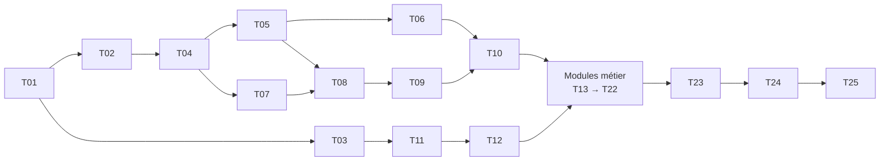

# Plan d'exécution — Lot 1

> Source : `specs.md` (approuvé) et `design-system.md` (approuvé). Chaque tâche est atomique, livrée
> avec ses tests, et respecte CLAUDE.md : fail-fast, 200 lignes au plus par fichier, traçabilité.
> **Définition de « terminé »** : lint, typage et tests verts ; critères de la tâche vérifiés par commande ;
> aucune règle d'architecture violée.

## Vue d'ensemble

## Fondations

| ID | Agent | Tâche | Livrable vérifiable | Dépend de |
| --- | --- | --- | --- | --- |
| T01 | @architect | Ossature du dépôt | `git init`, `.gitignore` (`.env` exclu), `.editorconfig`, dossiers `backend/ frontend/ e2e/ infra/ docs/` | — |
| T02 | @backend | Squelette backend | uv + Python 3.12, ruff, mypy strict, pytest + couverture, **import-linter** (règle de dépendance), script « fichiers ≤ 200 lignes », config fail-fast, `create_app()`, `GET /api/v1/health`, gestionnaire d'erreurs `{"error":…}` | T01 |
| T03 | @frontend | Squelette frontend | Vite + React 18 + TS strict, Tailwind v4 + `tokens.css` (design-system § 9.1), ESLint (pas de valeur arbitraire, pas d'élément brut dans `features/`), vitest, size-limit (3 Mo), `shared/format` (montant, date, heure) testé, page `/_ui` | T01 |
| T04 | @backend | Noyau partagé du domaine | `Money`, `Quantity`, `DocNumber`, UUIDv7, `DomainError` et ses codes, événements, `BusinessDay` (Africa/Douala) — tests de propriétés | T02 |
| T05 | @backend | Ports de base + adaptateur mémoire | `UnitOfWork`, `Clock`, `DocumentNumberAllocator`, gabarit de dépôt lié à une boutique ; banc de tests de contrat `--backend=memory` | T04 |
| T06 | @backend | Adaptateur PostgreSQL de base | SQLAlchemy 2, Alembic, UoW SQL, numérotation sans trou (verrou optimiste), `docker-compose.dev.yml` (Postgres + MinIO), contrats `--backend=postgres` verts | T05 |
| T07 | @backend | Sécurité applicative | `Actor`, `Permission`, `role_matrix.py` = CDC § 4.2, `Policy` ; test paramétré cellule par cellule | T04 |
| T08 | @backend | Identité et sessions | login téléphone + code (Argon2id), blocage 5 essais / 15 min, changement de code (refus des codes simples), sessions par appareil, rotation du refresh, révocation | T05, T07 |
| T09 | @backend | Journal, alertes, droits d'offre | handlers d'événements dans la même transaction, journal en ajout seul, alertes dédupliquées, port `Entitlements` (`offline_capture` = faux) | T08 |
| T10 | @backend | Boutiques et plateforme | `OpenShop` (profil Motos : 3 lieux, catégories, modes de paiement), membres, lieux, réglages, profil d'impression ; API plateforme | T06, T09 |
| T11 | @frontend | Composants atomiques | Button, Field/AmountField, QuantityStepper, ChoiceChips, Disclosure, SearchField, Cards, Badge, Toast, Banner, ConfirmDialog, EmptyState, TopBar, BottomNav — tous dans `/_ui`, axe sans violation | T03 |
| T12 | @frontend | Cœur applicatif | client API généré (OpenAPI), session + refresh unique, garde par rôle, coquille et menus pilotés par le profil, bannière « Connexion nécessaire », écrans connexion et changement de code, console plateforme | T11, T10 |

## Modules métier (une paire back/front par module)

| ID | Agent | Module | Points clés | Dépend de |
| --- | --- | --- | --- | --- |
| T13 | @backend | Catalogue | articles du profil Motos (marque + modèle uniques), prix de base et minimum, historique de prix, archivage | T10 |
| T14 | @backend | Stock | mouvements, projection `stock_level`, ajustements, inventaire, valeur du stock, alerte de stock bas | T13 |
| T15 | @backend | Achats | fournisseurs, achats, **Costing** (prorata des frais, dernier coût, CMP, rejeu), corrections et annulation, paiements | T14 |
| T16 | @backend | Ventes | vente comptant et crédit, coûts figés, châssis unique, demandes de prix, retours, signalements, clients, DTO de reçu | T15 |
| T17 | @backend | Créances | créance (ouverte par la vente ou ancienne), versements, rappels, garants, mise en perte | T16 |
| T18 | @backend | Dépenses | dépenses, catégories, tags (fusion), répétition | T10 |
| T19 | @backend | Reporting | tableau de bord (§ 14.1), détails, accueils par rôle | T16, T17, T18 |
| T20 | @frontend | Écrans Catalogue, Stock, Achats | | T12, T13–T15 |
| T21 | @frontend | Écrans Ventes, Reçus (3 profils d'impression), Créances, Clients | vente en 4 gestes | T12, T16, T17 |
| T22 | @frontend | Écrans Dépenses, Tableau de bord, Alertes, Journal, Réglages | | T12, T18, T19 |

## Clôture du lot

| ID | Agent | Tâche | Livrable | Dépend de |
| --- | --- | --- | --- | --- |
| T23 | @backend + @frontend | Ossature hors-ligne **désactivée** | outbox Dexie, `/sync` (`403 FEATURE_DISABLED`), testée avec le droit activé | T21 |
| T24 | @qa | Recette | E2E A1–A10, non-fuite des coûts, isolation des boutiques, axe, Lighthouse en 3G, poids | T22, T23 |
| T25 | @backend | Déploiement | compose de production, Caddy + `sslip.io`, sauvegardes (étape 1), projet Vercel + rewrite `/api` | T24 |

## Prérequis machine

- `uv` 0.13.7 installé dans `%APPDATA%\Python\Python310\Scripts\uv.exe` (pas encore dans le `PATH`) ; Python 3.12 géré par uv.
- Node 24, npm 11, Docker 29 + Compose v5, git, gh.
