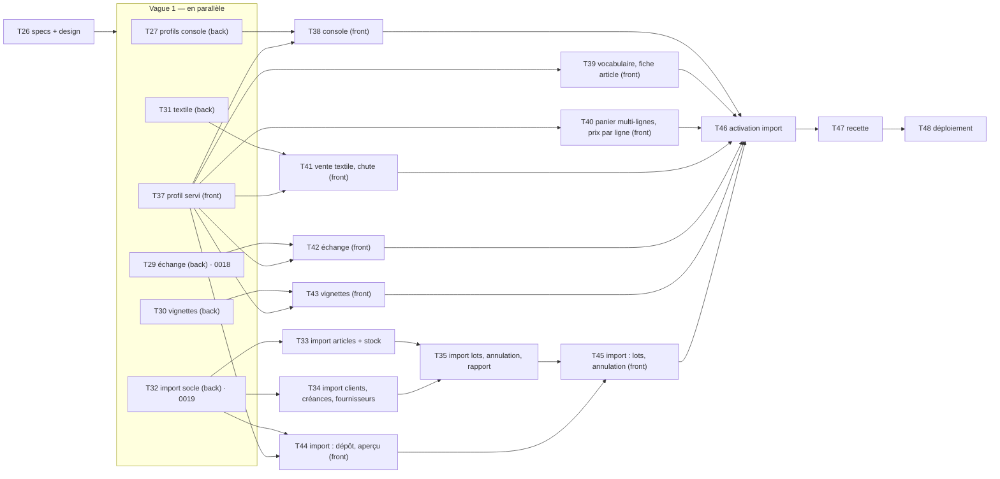

# Plan d'exécution — Lot 3 (Extension : Prêt-à-porter, Textile, Import Excel)

> Source : `specs.md` (approuvé), `design-system.md`, CDC § 15, § 18, § 19, § 20.9. Décision client du
> 2026-11-13 : **le Lot 3 passe avant le Lot 2** (`docs/plan-lot2.md` : brouillon mis en attente).
> Mêmes règles que le Lot 1 : fail-fast, 200 lignes au plus par fichier, chaque tâche livrée avec ses tests.
> **Définition de « terminé »** : lint, typage et tests verts (mémoire **et** PostgreSQL), `lint-imports` vert,
> contrat OpenAPI régénéré et client TS synchronisé (`npm run check:api`), critères de la tâche vérifiés.
> Recette : `docs/recette-lot3.md` (tests unitaires et d'intégration seulement, pas d'E2E — décision client).

## Décisions du client (2026-11-13) — à appliquer à la lettre

Reportées dans `specs.md` § 15.1 (une ligne par décision). Elles **remplacent** les recommandations du tableau ci-dessous.

| # | Décision | Effet sur le plan |
| --- | --- | --- |
| QC-1 | La boutique « Pret a Porter » ouverte en Motos en production est **recréée** sur le profil Prêt-à-porter (l'ancienne passée « suspendue »). La console garde « Changer le type de boutique », permis **seulement** pour une boutique sans données | T27, T38, T48 inchangées |
| QC-2 | **Pas de remise** : « On ne gère pas les remises… on enregistre juste les prix au moment de la vente… les prix ça se négocie ». Le prix de chaque ligne est saisi ou négocié à la vente ; règles du prix minimum du Lot 1 inchangées (avertissement + journal). Aucune architecture de remise | **T28 supprimée** ; T40 = « Panier multi-lignes (taille, couleur, prix négocié par ligne), sans remise » |
| QC-3 | Stock textile **au dixième** (inchangé) ; les écarts se corrigent par inventaire ou chute | **T36 supprimée** ; SCN-L3-02 au dixième seulement |
| QC-4 | Échange par l'employé = réglage `employee_exchange_allowed`, **désactivé par défaut** ; activé : **ses** ventes, **dans** le délai ; le propriétaire peut dépasser le délai (journal sensible) | T29, T42 |
| QC-5 | Pas de réserve au Lot 3 : un seul lieu « Boutique », qui reçoit les achats ; avertissement si on crée un entrepôt | T27, T39 |
| QC-6 | Annulation d'import = **archivage** (rien d'effacé, noms et téléphones libérés) ; refusée si une vente, un achat, un ajustement, un inventaire ou un versement touche le lot ; possible **7 jours calendaires** | T35, T45 |

Migrations **renumérotées** : `0018_exchange_rights` (T29) → `0019_import_batches` (T32). Plus de `0018_sale_discount` ni de `0021_textile_centimeters`.

## Questions posées au client (historique)

Seules les ambiguïtés qui changeaient le modèle. Réponses : voir le tableau des décisions ci-dessus.

| # | Question | Recommandation | Par défaut sans réponse | Tâches |
| --- | --- | --- | --- | --- |
| QC-1 | La boutique « Pret a Porter » de la production tourne sur le profil **Motos** (lieux Garoua-Boulaï, Ngaoundéré, Garoua ; champs marque + modèle). Que contient-elle déjà (articles, ventes, achats) ? | Ajouter dans la console « Changer le type de boutique », permis **seulement** si la boutique n'a aucun article, mouvement, vente, achat, dépense ni créance (sinon refus avec la liste) ; le changement remplace les lieux inutilisés et les réglages par ceux du nouveau profil. Si elle a déjà des données : **recréer** la boutique sur le bon profil (et désactiver l'ancienne). | Changement de type si la boutique est vide ; sinon recréation par l'administrateur, l'ancienne passée « suspendue » | T27, T38, T48 |
| QC-2 | Remise sur le panier (§ 18.3, montant ou %) : comment la compter dans la marge, les retours et le prix minimum ? | Répartir la remise sur les lignes **au prorata** de leur montant (reste de l'arrondi sur la plus grosse ligne, comme les frais d'achat) : marge, retour et contrôle du minimum se font sur le prix **après remise**. Employé autorisé à remettre ; sous le minimum : même règle que le Lot 1 (avertissement + journal sensible, accord seulement si le réglage est actif) | Ce qui est recommandé | T28, T40 |
| QC-3 | Une pièce de wax mesure 5,49 m (6 yards) mais le stock est tenu au dixième de mètre (RG-T08) : 1 pièce vendue retire 5,5 m, 10 pièces vendues une à une retirent 55,0 m pour 54,9 m achetés, et la marge diffère de la formule RG-X04 (1 978 au lieu de 1 998 FCFA). | Tenir le stock **au centimètre** pour le mètre (saisie de vente toujours au dixième, longueur de pièce au centimètre) : stock et marge exacts | On garde le dixième : l'arrondi est fait par ligne, la dérive (≤ 5 cm par pièce) se corrige par inventaire ou chute ; T36 n'est pas lancée | T36, T31, T41 |
| QC-4 | Échange (UC-PAP-01) : l'employé peut-il le faire, et le délai s'applique-t-il au propriétaire ? | Réglage « L'employé peut faire un échange » (désactivé par défaut), sur **ses** ventes, dans le délai ; le propriétaire peut dépasser le délai (action sensible au journal). Article donné en échange : n'importe quel article (la différence est payée ou rendue) | Ce qui est recommandé | T29, T42 |
| QC-5 | « Une réserve facultative » (§ 18.1) : sans module Transferts (Lot 2), une marchandise mise en réserve ne peut pas revenir en boutique. | Pas de réserve proposée au Lot 3 (on ne montre jamais ce qui n'existe pas) : achats reçus à « Boutique » ; la création d'un entrepôt reste possible dans Réglages → Lieux mais avec l'avertissement « déplacement disponible plus tard ». La réserve arrive avec le Lot 2 | Ce qui est recommandé | T27, T39 |
| QC-6 | Annulation d'un import (UC-IMP-03) : que deviennent les éléments créés, et qu'est-ce qui « s'appuie dessus » ? | Les éléments créés ne sont pas effacés (RG-T02) : articles archivés, fournisseurs et clients désactivés, créances annulées, stock de départ retiré par un mouvement « Annulation » ; leur nom, référence ou téléphone est **libéré** pour un nouvel import. Bloquent : toute vente, tout achat, ajustement, inventaire ou versement qui touche un élément du lot. Délai : 7 jours **calendaires inclus** à partir de la date de l'import (journée de Douala) | Ce qui est recommandé | T35, T45 |

## Constats sur l'existant (avant découpage)

| Sujet | Déjà livré au Lot 1 | Reste à faire au Lot 3 |
| --- | --- | --- |
| Profils | `domain/profiles/apparel.py` : `APPAREL` et `TEXTILE` (champs, menus § 18.5, rôles sans Chauffeur, libellé « Employé », reçu 58 mm, `exchange_days` 7, une « Boutique ») ; `GET /profile` renvoie menu, rôles, champs, unités | console : seul « Motos » est proposé (`platformNav.ts`) ; **frontend écrit en dur sur Motos** (`core/profile/motos.ts`, `profileForShop`) ; aucun changement de type possible (`Shop.profile_code` sans mutateur) |
| Textile | `Quantity` METER au dixième, `SaleMode` unit/meter/piece, `stock_quantity` (pièce → mètres), saisie d'achat en yards (`EntryUnit.YARD`), prix à la pièce, ajustement « Chute » | écran de vente : mode pris sur l'article, pas de choix « Au mètre / À la pièce », pas de raccourcis (RG-X05) ; « Déclarer une chute » absent de la fiche article ; précision : dixième gardé (QC-3) |
| Prêt-à-porter | plusieurs lignes par vente, détails taille et couleur, prix saisi par ligne, échange (retour + nouvelle vente) par le propriétaire, nom d'article unique | aucune remise, **et il n'en faut pas** (QC-2) ; écran : panier multi-lignes à finir ; délai d'échange non appliqué ; pas d'échange par l'employé ; pas de photo d'article ni de vignettes (UC-PAP-02) |
| Import | permissions `IMPORT_*` dans la matrice, `DocType.IMPORT` (`IMP-`), `MovementType.OPENING`, `SourceType.IMPORT`, créance ancienne (UC-CRE-02) | tout le reste : ports tableur, `openpyxl` absent de `pyproject.toml`, tables, routes, écrans ; `import` est dans `UPCOMING_MODULES` |
| Migrations | tête : `0017_upcoming_modules` | 0018 et 0019 réservées ci-dessous |

Hors Lot 3 (dépendent du Lot 2, **exclus explicitement**) : modèles d'import **Camions** et **Chauffeurs** (le type d'import n'existe pas dans l'énumération, il n'est jamais montré) ; module `transfers` « si réserve » (QC-5) ; rôle Chauffeur dans « Membres » (suivi Lot 1, reste au Lot 2).
Écart avec `specs.md` § 6.3 et § 14 (« 7 modèles ») : 5 modèles au Lot 3, les 2 autres au Lot 2 — reporté dans les specs par T26.

## Vue d'ensemble et vagues parallèles

| Vague | Tâches parallèles | Conflits évités par |
| --- | --- | --- |
| 0 | T26 | — |
| 1 | T27, T29, T30, T31, T32, T37 (6) | contextes séparés (`platform`, `sales` échange, `catalog` photo, `profiles`/`sales` textile, `imports`, frontend `core/profile`) |
| 2 | T33, T34, T38, T39, T40, T41, T42, T43, T44 (9) | un dossier `features/` par écran ; deux modèles d'import par tâche |
| 3 | T35, T45 | — |
| 4 | T46 → T47 → T48 | — |

## Règles de parallélisme

1. **Migrations** : une seule tête. Numéros **réservés** et chaînés à l'avance (renumérotés après QC-2 et QC-3) : `0018_exchange_rights` (T29, précédente 0017) → `0019_import_batches` (T32). Aucune migration de remise ni de stock au centimètre. Les tâches se développent en parallèle mais **fusionnent dans l'ordre des numéros** ; si une migration réservée est abandonnée, la suivante se rebase sur la tête réelle. Critère commun : `alembic heads` = 1, `upgrade head` puis `downgrade -1` verts sur PostgreSQL.
2. **Fichiers générés** (`openapi.json`, `frontend/src/core/api/schema.gen.ts`) : jamais fusionnés à la main ; après rebase, on relance le générateur.
3. **Fichiers partagés connus** : `role_matrix.py` (seule T29 y touche ; aucune permission de remise), `bootstrap/imports.py` (T33 et T34 ajoutent chacune une ligne : conflit trivial), menus de profils (seule T32 y ajoute l'entrée « Import », masquée tant que le module est à venir).
4. Un module n'est retiré de `UPCOMING_MODULES` (serveur **et** miroir `core/profile/modules.ts`) qu'**après** que tous ses écrans existent : T46, en dernier.

## Tâches

| ID | Agent | Tâche | Critères de fin (vérifiables) | Dépend de |
| --- | --- | --- | --- | --- |
| T26 | @architect | Specs et design du Lot 3 | `specs.md` : décisions QC-1 à QC-6 datées 2026-11-13 (§ 15.1), routes Lot 3 (§ 6.3 : `POST /platform/shops/{id}/profile`, panier multi-lignes à prix par ligne dans `POST /sales` **sans remise**, `/imports…`), nouveaux codes d'erreur (§ 6.2 : `PROFILE_CHANGE_BLOCKED`, `EXCHANGE_PERIOD_OVER`, `IMPORT_FILE_INVALID`, `IMPORT_TOO_MANY_ROWS`, `IMPORT_PREVIEW_EXPIRED`, `IMPORT_CANCEL_BLOCKED`, `IMPORT_CANCEL_TOO_LATE`), 5 modèles au lieu de 7, camions et chauffeurs au Lot 2 (§ 14) ; `design-system.md` : panier multi-lignes sans remise, bascule « Au mètre / À la pièce » + raccourcis, grille de vignettes, écrans d'import (aperçu des erreurs « Ligne 14 : le prix est vide ») | réponses QC (reçues le 2026-11-13) |
| T27 | @backend | Profils à l'ouverture et changement de type (`platform`) | ouverture Prêt-à-porter et Textile vérifiée (1 lieu « Boutique » point de vente, reçu 58 mm, rôles sans Chauffeur, libellé « Employé », modules disponibles du profil) ; UC `ChangeShopProfile` + `POST /platform/shops/{id}/profile` : refus `422 PROFILE_CHANGE_BLOCKED` (`details.blocking` : articles, mouvements, ventes, achats, dépenses, créances, membres d'un rôle absent du profil) ; sinon lieux inutilisés désactivés, lieux, réglages, catégories du nouveau profil créés ; journal sensible ; admin seul (403 sinon) ; aucune migration | T26 |
| ~~T28~~ | — | ~~Remise sur le panier (§ 18.3)~~ — **supprimée (QC-2)** : pas de remise, le prix se négocie par ligne | — | — |
| T29 | @backend | Échange prêt-à-porter (UC-PAP-01) | délai `exchange_days` appliqué (`422 EXCHANGE_PERIOD_OVER`, propriétaire : dépassement journalisé sensible, QC-4) ; réglage `employee_exchange_allowed` (défaut faux) ; activé : l'employé échange **ses** ventes dans le délai ; permission `SALE_EXCHANGE` (Propriétaire Tout, Vendeur Siens si réglage) ; matrice et test paramétré à jour ; migration **0018_exchange_rights** (précédente 0017) | T26 |
| T30 | @backend | Vignettes d'article (UC-PAP-02, côté serveur) | la photo existe déjà (`article.photo_id`, pièce jointe `article`) ; `GET /articles?with_thumbnails=true` renvoie un lien signé court par article **après** contrôle des droits (une requête, pas une par article) ; aucune migration ; pas de coût dans la réponse vendeur | T26 |
| T31 | @backend | Textile : compléments serveur | raccourcis RG-X05 dans `GET /profile` (pièce, demi-pièce, 1, 2, 3 m ; nouveau fichier de profil) ; reçu : « 2,5 m », « 1 pièce (5,49 m) » ; prix minimum à la pièce ; retour d'une ligne vendue à la pièce ; « Chute » (UC-TEX-03) : ajustement avec motif Chute, longueur, photo ; tests RG-X01 à RG-X06 sur le jeu de la recette | T26 |
| T32 | @backend | Import : socle | ports `SpreadsheetReader/Writer` (adaptateurs `openpyxl` + CSV virgule/point-virgule, dépendance verrouillée) ; domaine `ImportBatch` (`IMP-000001`, statuts Importé/Annulé), nettoyage des montants (« 1 250 000 », « 1250000 FCFA »), limite 5 000 lignes (`IMPORT_TOO_MANY_ROWS`), erreurs ligne/colonne ; `GET /imports/templates/{kind}` (feuille « Mode d'emploi », listes déroulantes lieux, catégories, types de client) ; `POST /imports/preview` (fichier gardé via `FileStorage`, renvoie `preview_id`, aperçu sans écriture, valable 30 min) ; registre des modèles ; routes `x-module: import` ; entrée « Import » dans les menus des profils ; migration **0019_import_batches** (`import_batch`, `import_item`, précédente 0018) | T26 |
| T33 | @backend | Import Articles et Stock de départ | articles du profil (Motos : marque + modèle ; Textile : unité, longueur de pièce) ; stock de départ : mouvement « Reprise de départ », coût unitaire = premier CMP et dernier coût ; doublons (même article + lieu, article déjà existant) signalés et ignorés ; « 3 articles nouveaux seront créés » ; `POST /imports` (`preview_id`, lignes valides seulement) dans une transaction ; journal ; comptable autorisé | T32 |
| T34 | @backend | Import Clients, Créances en cours, Fournisseurs | clients (doublon = même téléphone), créances anciennes via UC-CRE-02 (client créé si nouveau, vendeur responsable facultatif), fournisseurs (doublon = même nom) ; module éteint (`receivables`, `purchases`) → `403 MODULE_DISABLED` ; comptable : clients et créances → 403 | T32 |
| T35 | @backend | Import : lots, annulation, rapport | `GET /imports`, `GET /imports/{id}` ; `GET /imports/{id}/errors.xlsx` ; `POST /imports/{id}/cancel` (propriétaire, QC-6 : `IMPORT_CANCEL_TOO_LATE`, `IMPORT_CANCEL_BLOCKED` avec la liste des opérations) ; clés d'unicité libérées ; journal | T33, T34 |
| ~~T36~~ | — | ~~Stock textile au centimètre~~ — **supprimée (QC-3)** : stock au dixième, écarts corrigés par inventaire ou chute | — | — |
| T37 | @frontend | Profil servi par le serveur | `profileForShop` lit `GET /profile` (fin du provisoire `motos.ts`) : menus par code → route et icône (code inconnu = erreur), libellés de rôle (« Employé »), rôles proposés dans « Membres » = rôles du profil, champs d'article et de vente ; tests sur les 3 profils ; budget de poids inchangé | T26 |
| T38 | @frontend | Console : type de boutique | choix Motos / Prêt-à-porter / Textile à l'ouverture ; fiche : « Changer le type de boutique » avec confirmation et affichage des blocages (T27) | T27, T37 |
| T39 | @frontend | Vocabulaire et fiche article par profil | aucun « modèle », « marque » obligatoire, « châssis », « Garoua », « Vendeur » dans les écrans Prêt-à-porter et Textile (test qui balaie le DOM des écrans principaux) ; fiche article Textile (unité, vente à la pièce, longueur, prix au mètre et à la pièce) ; garde-fou du nom en double à la création (suivi Lot 1) ; avertissement d'entrepôt (QC-5) | T37 |
| T40 | @frontend | Panier multi-lignes (taille, couleur, prix négocié par ligne), sans remise | panier multi-lignes avec taille et couleur (listes rapides XS–XXL, 36–46, couleurs), prix de base pré-rempli et modifiable **par ligne**, total = somme des lignes recalculé à chaque changement, avertissement sous le minimum (règle du Lot 1 : vente acceptée, journal) ; aucun champ, ligne ni libellé de remise (test) ; reçu ligne par ligne puis total (design-system § 7.4) | T37 |
| T41 | @frontend | Vente textile et chute | bascule « Au mètre / À la pièce », raccourcis, prix calculé modifiable, stock affiché en mètres ; « Déclarer une chute » sur la fiche article (longueur, note, photo) ; formats « 2,5 m » | T31, T37 |
| T42 | @frontend | Échange et réglages | « Échanger » depuis la vente (propriétaire ; employé si réglage), délai affiché ; Réglages : délai d'échange, autorisation de l'employé | T29, T37 |
| T43 | — | ~~Vignettes et photo d'article~~ **reportée** (décision client du 2026-11-13 : photos jamais obligatoires, recherche par le texte) | — | — |
| T44 | @frontend | Import : modèle, dépôt, aperçu, confirmation | choix du modèle (comptable : 3 modèles), téléchargement, dépôt .xlsx/.csv, aperçu (valides, erreurs « Ligne 14 : … », éléments créés), « Importer les lignes valides », rapport ; écran chargé à la demande | T32, T37 |
| T45 | @frontend | Import : lots et annulation | liste des lots, détail, rapport d'erreurs, « Annuler l'import » (propriétaire) avec les opérations qui bloquent | T35, T44 |
| T46 | @backend + @frontend | Activation du module `import` | `import` retiré de `UPCOMING_MODULES` (serveur et miroir client), interrupteur dans la console, profils ouvrant `import` ; aucune boutique existante modifiée par migration (l'administrateur l'active) ; OpenAPI final | T35, T38–T45 |
| T47 | @qa | Recette Lot 3 | `docs/recette-lot3.md` exécutée (unitaires + intégration), résultats dans `docs/recette-lot3-resultats.md` | T46 |
| T48 | @backend | Déploiement | migrations 0018 et 0019 sur le VPS, images reconstruites (`openpyxl`), frontend VPS + Vercel ; boutique « Pret a Porter » **recréée** sur le profil Prêt-à-porter et l'ancienne passée « suspendue » (QC-1) ; numéro de version vérifié par `GET /health` | T47 |

## Suivi repris du Lot 1

| Origine | Élément | Porté par |
| --- | --- | --- |
| Audit UX (2026-11-13) | Profil Prêt-à-porter : une boutique « Pret a Porter » tourne sur le profil Motos | T27, T38, T48 (QC-1) |
| Audit UX (2026-11-13) | Nom d'article en double (« Robe Bleu Marine Robe ») : garde-fou à la création | T39 |
| T12 | Profil provisoire Motos écrit en dur dans le frontend | T37 |
| Audit UX (2026-11-13) | Rôle Chauffeur proposé dans « Membres » | T37 pour Prêt-à-porter / Textile (rôles du profil) ; Motos : Lot 2 |
| Audit UX (2026-11-13) | Accueils comptable et chauffeur (lignes Lot 2) | Lot 2 (inchangé) |
