# Gestion de boutiques — Spécification technique

> Source fonctionnelle : `Cahier des charges — Application de gestion de boutiques.md` (ci-après **CDC**).
> Les références `UC-xxx`, `RG-xxx`, `Hxx` renvoient au CDC. Ce document dit **comment** on construit ; le CDC dit **quoi**.
> L'identité visuelle (tokens, composants) fera l'objet de `design-system.md` (étape 3).

## 1. Overview

Application web progressive (PWA) de gestion de boutique — stock multi-lieux, achats, ventes et reçus, créances, dépenses, transferts, transport (camions, voyages, paie chauffeurs), tableau de bord, import Excel et journal d'actions — déclinée en trois **profils de boutique** (Motos et camions, Prêt-à-porter, Textile) qui ne sont que des réglages d'un même socle.

- **Backend** : Python 3.12 + FastAPI, organisé en **Clean Architecture stricte** (domaine pur → cas d'utilisation → ports → adaptateurs). PostgreSQL est l'adaptateur de persistance par défaut ; **changer de base = écrire un nouvel adaptateur**, sans toucher au domaine, aux cas d'utilisation ni à l'API.
- **Frontend** : React 18 + TypeScript strict + Vite + Tailwind, PWA installable. Le **hors-ligne** (vente, dépense, étape et dépense de voyage) sera une **fonction premium** : son ossature est construite dès le Lot 1 mais reste **désactivée** (droit d'offre `offline_capture`, faux par défaut). Pas de notifications sur le téléphone en V1. Interface minimaliste, sans bibliothèque d'animation.
- **Multi-boutique** : chaque requête métier est liée à une boutique (`shop_id`) ; l'isolation est garantie par la couche application, pas par une fonctionnalité propre à une base.
- **Déploiement** : VPS + Docker Compose (Caddy, API, worker, PostgreSQL, MinIO, sauvegardes). Le frontend est servi **à la fois** par le VPS et par Vercel, dès le départ, avec la même origine apparente pour l'API (proxy `/api`).
- **Livraison par lots** (la spec couvre tout) : Lot 1 cœur de boutique Motos, Lot 2 transferts et transport, Lot 3 import Excel et profils Prêt-à-porter / Textile (§ 14).

## 2. System Context

### 2.1 Existant

L'espace de travail ne contient que le CDC, `CLAUDE.md` et un `README.md` hérité d'un projet antérieur (Todo App). **Aucun code à réutiliser.** On reprend toutefois les conventions éprouvées de ce projet : format d'erreur `{"error": {code, message, details}}`, Argon2, types d'API générés depuis OpenAPI, Playwright + axe-core, configuration validée au démarrage (fail-fast). Le `README.md` sera réécrit au Lot 1.

### 2.2 Diagramme de contexte

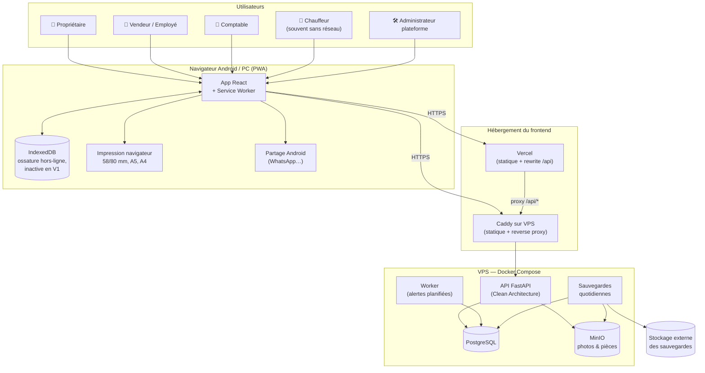

L'application **n'encaisse rien** et **n'envoie rien aux clients** (CDC § 1.4, H19) : aucune intégration de paiement ni de SMS en version 1.

## 3. Technical Requirements

Chaque exigence technique (TR) est tracée vers le CDC.

| TR | Exigence technique | Source CDC |
| --- | --- | --- |
| TR-01 | Le domaine (entités, règles) n'importe ni FastAPI, ni SQLAlchemy, ni Pydantic. La règle de dépendance est vérifiée en CI (`import-linter`). | Décision de cadrage |
| TR-02 | Toute persistance passe par des **ports** (interfaces abstraites). Une même suite de tests de contrat tourne sur l'adaptateur mémoire et sur l'adaptateur PostgreSQL. | Décision de cadrage |
| TR-03 | Chaque cas d'utilisation reçoit un `Actor` (utilisateur, rôle, boutique, appareil) ; les dépôts sont construits **pour une boutique** et ne peuvent rien lire hors de celle-ci. | § 1.4, § 21 Séparation, UC-SOC-03 |
| TR-04 | Les droits sont des **permissions** vérifiées dans la couche application à chaque appel ; un refus lève `Forbidden` et écrit « Accès refusé » au journal. | RG-D01, § 4.2 |
| TR-05 | Les réponses sont construites par des **présentateurs par rôle** : un vendeur ne reçoit jamais de champ coût, CMP, marge ni valeur du stock ; un chauffeur ne reçoit aucun prix. | RG-D02 à RG-D05 |
| TR-06 | Montants : entiers FCFA (`int` dans le domaine, `BIGINT` en base). Quantités : `Decimal` au dixième (objet-valeur `Quantity`), entières pour les unités « Unité/Pièce ». | H2, RG-T07, RG-T08 |
| TR-07 | Horodatages en UTC ; la « journée » est calculée en `Africa/Douala` par un port `Clock`. Chaque enregistrement garde `captured_at` (appareil), `received_at` (serveur), `device_id`. | H3, RG-T04 |
| TR-08 | Rien n'est supprimé : annulation (`cancelled_at/by/reason`) ou modification (avant/après au journal). Aucune route `DELETE` sur les données métier. | RG-T02, RG-T03, H11 |
| TR-09 | Chaque cas d'utilisation qui modifie l'état émet des **événements de domaine** ; le journal et les alertes sont écrits **dans la même transaction**. Le journal est en ajout seul (aucun port de mise à jour ni de suppression). | RG-T01, RG-J01 |
| TR-10 | Numéros de document continus et sans trou, par boutique et par type, attribués dans la transaction de création (port `DocumentNumberAllocator`). | RG-T05 |
| TR-11 | Hors-ligne (**ossature livrée, désactivée par défaut**, activable boutique par boutique via le droit `offline_capture`, fonction premium) : la vente, la dépense, l'étape et la dépense de voyage sont mises en file dans IndexedDB avec un identifiant client (UUIDv7) et un numéro provisoire `X-HL-<appareil>-<seq>`, puis envoyées dans l'ordre par `POST /sync`. Le serveur est **idempotent** sur l'identifiant client. | H12, RG-T06, RG-T22 à RG-T24 |
| TR-12 | Une vente reçue en différé est toujours acceptée ; si le stock devient négatif, elle porte `stock_to_verify = true` et une alerte est émise. En ligne, un stock négatif est refusé (`STOCK_INSUFFICIENT`, avec le stock disponible). | H13, RG-T17, RG-T18 |
| TR-13 | Le stock est la somme des mouvements ; une **projection** `stock_level` (vendable, abîmé, en route) est mise à jour dans la même transaction que le mouvement, avec un verrou optimiste (`version`). | H21, RG-T16 |
| TR-14 | Coûts : coût unitaire d'achat avec part des frais au prorata (RG-T10), dernier coût (RG-T11), CMP global (RG-T12). Une correction ou une annulation d'achat **rejoue** le CMP à partir des mouvements ; les coûts figés des ventes ne bougent jamais. | RG-T10 à RG-T15, H5, UC-ACH-03/04 |
| TR-15 | Les profils de boutique (modules, champs d'article, détails de vente, rôles, libellés, réglages par défaut) sont des **données de configuration** du domaine, exposées au frontend par `GET /shops/{id}/profile`. Ajouter un profil n'impose de réécrire aucun module commun. | § 3, § 21 Évolutivité |
| TR-16 | Authentification par téléphone + code à 6 chiffres (hash Argon2id), blocage 15 min après 5 échecs, session par appareil révocable à distance, code provisoire à changer à la première connexion. | H14, UC-SOC-02, UC-SOC-07, RG-D06, RG-D07 |
| TR-17 | Pièces jointes : JPG, PNG ou PDF ≤ 5 Mo, réduites côté client avant l'envoi, stockées via le port `FileStorage` (MinIO/S3), servies par une URL signée courte **après** contrôle des droits. | RG-T26, UC-CRE-07 |
| TR-18 | Reçus et bordereaux rendus **côté client** à partir d'un DTO de reçu (HTML + CSS `@page` par format), donc imprimables hors-ligne ; le PDF de partage est produit côté client par un module chargé à la demande. Une réimpression porte « Duplicata ». Format et réglages d'impression (largeur, marges, taille du texte) : configuration de la boutique (§ 9.1). | H22, UC-VEN-04 |
| TR-19 | Le worker exécute des tâches planifiées idempotentes : rappels de créance, expiration des demandes de prix (30 min), documents à renouveler (J-30), camion sans étape (24 h), déplacement en route (7 j). | UC-CRE-06, UC-VEN-03, UC-TRA-01/02/09, UC-TRF-03 |
| TR-20 | Performance : premier chargement visé < 2 Mo, **plafond 3 Mo** (bloquant en CI), écran < 2 s en 3G, recherche d'article dès la première lettre (sur le catalogue local), budgets vérifiés en CI. | § 21 Rapidité, Poids |
| TR-21 | Tableau de bord calculé par des **ports de requête** (lecture seule), jamais affiché hors ligne. | UC-TDB-01, RG-T25, § 14.1 |
| TR-22 | Import Excel/CSV : modèles `.xlsx` générés, aperçu ligne par ligne sans écriture, ≤ 5 000 lignes, lot numéroté et annulable sous 7 jours tant que rien ne s'appuie dessus. | § 15 |
| TR-23 | Console de l'Administrateur plateforme (domaine `platform`) : création de boutique et de propriétaire, modules actifs, statut. Aucun accès aux données d'une boutique sans délégation explicite du propriétaire. | UC-SOC-01, § 4.1 |
| TR-24 | Disponibilité 99 %, sauvegarde quotidienne gardée 30 jours, restauration testée chaque mois, conservation 10 ans. | § 21, H23 |
| TR-25 | Fail-fast : aucune exception avalée ; toute erreur métier est une sous-classe typée de `DomainError` avec un code stable ; une configuration invalide arrête le démarrage. | CLAUDE.md, Iron Laws |
| TR-26 | **Droits d'offre** : port `Entitlements` qui lit l'offre du compte commerçant (`plan`) et les surcharges posées par l'administrateur plateforme. En V1, un seul droit existe, `offline_capture`, et il est inactif : `POST /sync` répond `403 FEATURE_DISABLED`, le client n'écrit jamais dans la file d'envoi et une coupure affiche « Connexion nécessaire ». L'activer ne demande aucun redéploiement. | § 1.1 (offres futures), H12 |

## 4. Components & Architecture

### 4.1 Couches et règle de dépendance

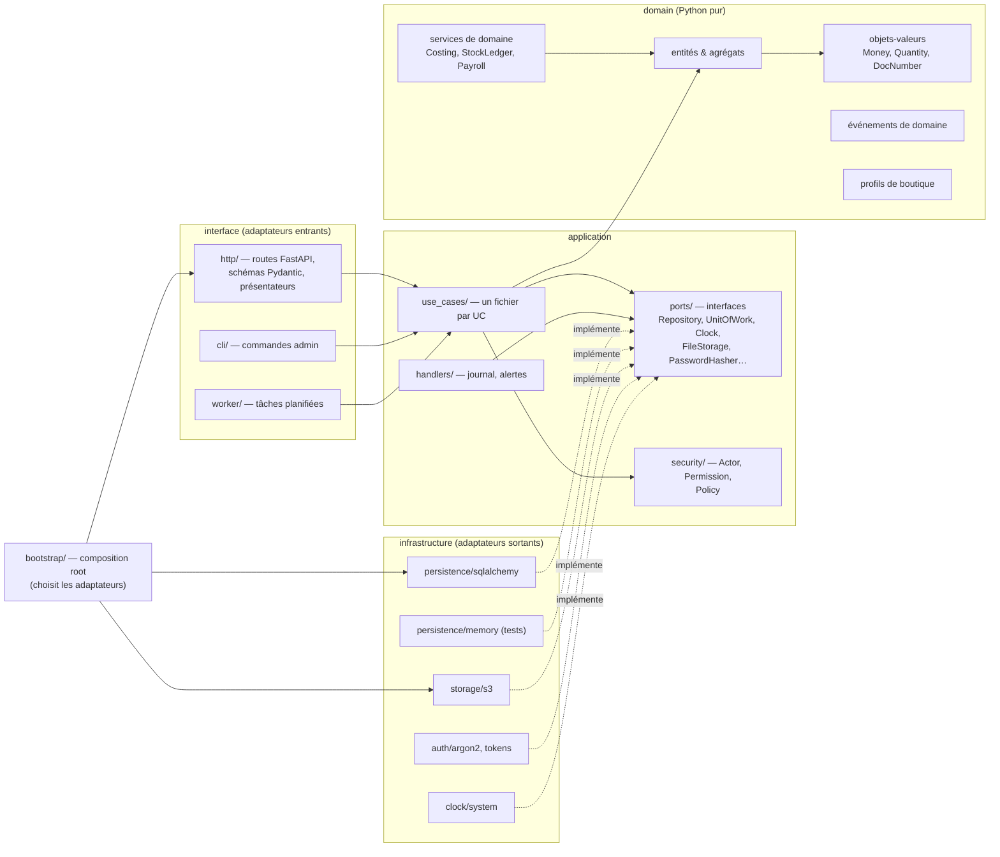

**Règles (vérifiées par `import-linter` en CI) :**

1. `domain` n'importe que la bibliothèque standard.
2. `application` importe `domain`, jamais `infrastructure` ni `interface`.
3. `infrastructure` importe `application.ports` et `domain`, jamais `interface`.
4. `interface` importe `application`, jamais `infrastructure` (l'injection passe par `bootstrap`).
5. Seul `bootstrap/container.py` connaît les adaptateurs concrets. **Changer de base = changer une ligne de configuration (`PERSISTENCE_BACKEND`) + fournir l'adaptateur.**

### 4.2 Contextes métier (modules)

Chaque module du CDC est un **contexte délimité**, présent dans chacune des couches avec le même nom. Un contexte ne lit jamais directement les tables d'un autre ; il passe par le port ou le cas d'utilisation exposé (ex. `sales` appelle `StockLedger.record_sale_exit`).

| Contexte | Module CDC | Lot |
| --- | --- | --- |
| `identity` | Connexion, appareils, codes | 1 |
| `shops` | Socle : boutiques, rattachements, lieux, réglages, modes de paiement, profils | 1 |
| `platform` | Console de l'Administrateur plateforme | 1 |
| `catalog` | Articles, historique de prix | 1 |
| `stock` | Mouvements, projection, inventaires, ajustements, stock abîmé | 1 |
| `purchasing` | Fournisseurs, achats, frais, paiements fournisseur | 1 |
| `sales` | Ventes, lignes, détails vendus, paiements, reçus, retours, demandes de prix, signalements, clients | 1 |
| `receivables` | Créances, versements, garants, rappels | 1 |
| `expenses` | Dépenses, catégories, tags | 1 |
| `alerts` | Alertes internes, notifications | 1 |
| `audit` | Journal d'actions (ajout seul) | 1 |
| `reporting` | Tableau de bord, valeur du stock (lecture seule) | 1 |
| `sync` | Réception des saisies hors ligne, instantané hors ligne | 1 |
| `attachments` | Pièces jointes | 1 |
| `transfers` | Déplacements de stock | 2 |
| `transport` | Camions, chauffeurs, voyages, étapes, chargements, dépenses de voyage, primes, avances, paie | 2 |
| `imports` | Modèles et lots d'import | 3 |

### 4.3 Arborescence backend (cible)

```
backend/
  pyproject.toml            # ruff, mypy strict, pytest, import-linter
  alembic/                  # migrations (adaptateur SQL uniquement)
  app/
    domain/
      shared/               # money.py, quantity.py, ids.py, errors.py, events.py, business_day.py
      shops/  catalog/  stock/  purchasing/  sales/  receivables/
      expenses/  transfers/  transport/  audit/  identity/
      profiles/             # motos.py, pret_a_porter.py, textile.py, registry.py
    application/
      ports/                # un fichier par port (repositories/<ctx>.py, uow.py, clock.py, storage.py…)
      security/             # actor.py, permissions.py, role_matrix.py, policy.py
      <ctx>/
        use_cases/          # record_sale.py, cancel_sale.py… (1 UC = 1 fichier)
        dto.py              # entrées/sorties des UC (dataclasses)
        queries.py          # ports de lecture spécifiques
      handlers/             # audit_recorder.py, alert_dispatcher.py
    infrastructure/
      persistence/
        sqlalchemy/         # tables/<ctx>.py, repositories/<ctx>.py, uow.py, numbering.py, queries/
        memory/             # adaptateurs en mémoire (tests, démo)
      storage/s3.py
      auth/argon2_hasher.py, tokens.py
      clock/system_clock.py
      excel/                # lecture/écriture xlsx (Lot 3)
    interface/
      http/
        app.py              # create_app()
        deps.py             # Actor depuis le jeton, UoW par requête
        errors.py           # DomainError → {"error": {...}}
        routes/<ctx>.py
        schemas/<ctx>.py    # Pydantic (contrat HTTP)
        presenters/<ctx>.py # DTO → schéma selon les permissions
      worker/main.py, jobs/*.py
      cli/main.py
    bootstrap/
      config.py             # pydantic-settings, validation fail-fast
      container.py          # composition root
  tests/
    domain/  application/  contracts/  http/  e2e_api/
```

Contrainte CLAUDE.md : **aucun fichier au-delà de 200 lignes** ; le découpage « 1 cas d'utilisation = 1 fichier » et « 1 dépôt par agrégat » le garantit.

### 4.4 Anatomie d'un cas d'utilisation

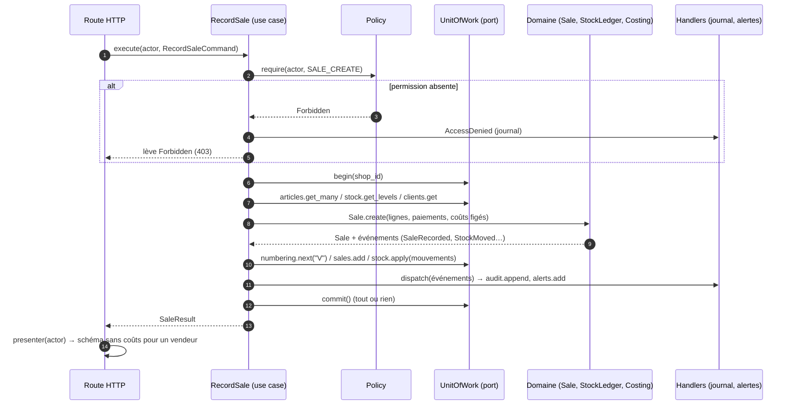

### 4.5 Profils de boutique

Un profil est un objet de domaine immuable, versionné dans le code ; la boutique garde en base son `profile_code` et ses surcharges (modules activés par l'administrateur, réglages).

| Élément du profil | Motos et camions | Prêt-à-porter | Textile |
| --- | --- | --- | --- |
| Modules | tous | tous sauf `transport` ; `transfers` si réserve | idem |
| Champs d'article | marque*, modèle*, cylindrée | nom*, référence, catégorie, type, marque | nom*, référence, type, unité*, vente à la pièce, longueur de pièce |
| Détails de vente | couleur, châssis (unique), moteur — 1 par unité | taille, couleur par ligne | longueur / mode (mètre ou pièce) |
| Unités | `UNIT` entier | `UNIT` entier | `METER` (0,1) ou `PIECE` |
| Rôles | Propriétaire, Vendeur, Comptable, Chauffeur | Propriétaire, Employé, Comptable | idem |
| Libellés | « Vendeur » | « Employé » | « Employé » |
| Défauts | 3 lieux, achats → Garoua-Boulaï, reçu 80 mm | 1 boutique, reçu 58 mm | idem |
| Menus (≤ 5 entrées) | CDC § 17.4 | § 18.5 | § 19.5 |

**Modules par boutique (décision client du 2026-11-12, § 15.1) — mise en œuvre serveur.**

- *Combinaisons* (`domain/profiles/modules.py`, `domain/shops/modules.py`) : obligatoires `core`, `audit`, `catalog`, `sales` ; dépendance `transport` ⇒ `transfers`. À l'ouverture comme au `PATCH /platform/shops/{id}` (liste **complète** des modules voulus), refus `422` : `MODULE_NOT_AVAILABLE` (hors profil), `MODULE_MANDATORY` (`details.module`), `MODULE_DEPENDENCY` (`details.module`, `details.requires`). Réglages par défaut des profils inchangés (Motos : tous). Migration `0015_mandatory_modules` : une boutique réglée avant la décision retrouve `catalog` et `sales`.
- *Routes* : chaque route `/shops/{shop_id}/…` déclare son module (extension OpenAPI `x-module`, posée par `interface/http/modules.py`, refus au démarrage d'une route sans module). Ordre : authentification → appartenance (non-membre `404`) → module (`403 MODULE_DISABLED`, `details.module`) → corps et traitement. Correspondance : `core` (profil, réglages, lieux, modes de paiement, membres, délégation, alertes, accueil `/home`, `/sync`, instantané, pièces jointes) ; `audit` (`/audit…`) ; `catalog` (articles, stock, ajustements, inventaires, mouvements) ; `sales` (ventes, reçus, signalements, demandes de prix, retours, clients) ; `purchases` (fournisseurs, achats et paiements) ; `receivables` (créances, rappels, garants, versements, relevé client) ; `expenses` (dépenses, catégories, tags) ; `dashboard` (`/dashboard`, détails). Le contenu d'une pièce jointe (lien signé, sans jeton) n'a pas de garde : le lien n'est délivré que par une route gardée.
- *Effets transverses* (cas d'utilisation, donc aussi en `POST /sync`) : sans `receivables`, vente ou échange à crédit et versement → `403 MODULE_DISABLED` (`details.module = receivables`), la tâche des rappels ne fait rien (aucun rappel consommé) ; sans `expenses`, dépense (y compris hors ligne) refusée ; pièce jointe d'un élément d'un module éteint (créance, dépense, achat) refusée à l'envoi comme au lien. Tableau de bord : bloc d'un module éteint à `null` — `summary.expenses` (aucune dépense lue, résultat simple = marge), `receivables`, `stock.in_transit` (`transfers`), `trucks` (`transport`) ; détail `expenses` ou `receivables` → `403 MODULE_DISABLED`. Accueils : `seller.reminders_due`, `accountant.expenses`, `accountant.transfers_to_receive`, blocs du chauffeur à `null`. L'argent encaissé reste l'argent réellement reçu. Alertes : aucune alerte d'un type dont le module est éteint (`domain/alerts/modules.py`). Données gardées, réapparues à la réactivation.
- *Profil* : `GET /shops/{id}/profile` renvoie `enabled_modules` effectifs et le menu sans les entrées d'un module éteint.

Les champs propres à un profil sont stockés dans une colonne `attributes` (JSON) validée par le **schéma du profil dans le domaine**, et non par la base. Les champs à contrainte d'unicité (marque + modèle, référence, châssis) sont promus en colonnes indexées.

### 4.6 Frontend

```
frontend/src/
  app/                  # routeur, providers, garde de rôle, shell (≤ 5 entrées de menu)
  shared/
    ui/                 # composants atomiques (design-system.md)
    format/             # money.ts « 1 250 000 FCFA », date.ts « 10/11/2026 », time.ts « 14 h 32 »
  core/
    api/                # client généré depuis openapi.json (jamais écrit à la main)
    auth/               # session, rafraîchissement unique (single-flight)
    offline/            # db.ts (Dexie), outbox.ts, sync.ts, snapshot.ts, connectivity.ts
    profile/            # useShopProfile() : menus, champs, libellés
    gateways/           # SalesGateway, ExpensesGateway… (en ligne ou file selon le réseau)
  features/
    dashboard/ sales/ receipts/ stock/ purchasing/ receivables/
    expenses/ transfers/ transport/ imports/ audit/ settings/ platform/
  sw.ts                 # service worker (précache + mise à jour au prochain lancement)
```

- Les écrans d'une fonctionnalité dépendent d'un **gateway** (interface TS) et non de `fetch`. Pour les quatre saisies éligibles au hors-ligne, le gateway choisit l'API ou la file d'envoi **seulement si le droit `offline_capture` est actif**. En V1 il est inactif : sans réseau, il lève `OfflineNotAllowed` et l'écran affiche « Connexion nécessaire », comme pour toutes les autres actions.
- Données serveur : TanStack Query ; données hors ligne : Dexie (IndexedDB).
- Les formulaires sont construits à partir du profil : les champs facultatifs vont sous « Plus de détails » (CDC § 1.3).
- Les écrans sont chargés à la demande par route ; la génération de PDF est un module séparé, chargé au premier partage.
- **Minimalisme** : aucune bibliothèque d'animation (Magic UI, Framer Motion écartés) ; transitions CSS courtes seulement, `prefers-reduced-motion` respecté.

### 4.7 Déploiement

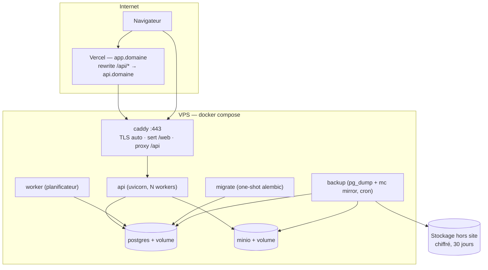

- **Une seule origine apparente** : sur Vercel, `/api/*` est proxifié vers le VPS ; sur le VPS, Caddy sert le même build et proxifie `/api`. Le cookie de session (httpOnly, `SameSite=Lax`, `Secure`) reste un cookie *first-party* dans les deux cas, sans CORS.
- Un même artefact de build frontend est déployé aux deux endroits (variable `VITE_API_BASE=/api`).
- **Adresses provisoires (avant un vrai nom de domaine)** : frontend Vercel sur l'adresse par défaut `<projet>.vercel.app`. L'API du VPS reçoit un nom DNS gratuit dérivé de son IP (`api.<ip-avec-tirets>.sslip.io`), ce qui permet à Caddy d'obtenir un certificat Let's Encrypt : le trafic Vercel → VPS reste chiffré (HTTPS), alors qu'un proxy vers `http://<ip>` ferait passer codes secrets et cookies en clair. Passer à un vrai domaine ne demandera que de changer deux variables (`API_PUBLIC_HOST`, cible du rewrite Vercel) et un enregistrement DNS.
- Les images Docker sont construites en CI et poussées sur un registre ; le VPS fait `docker compose pull && up -d`, et le conteneur `migrate` passe avant `api`.

## 5. Data Model

### 5.1 Conventions de persistance (adaptateur SQL)

| Convention | Choix |
| --- | --- |
| Identifiants | UUIDv7, générés **par le client** pour les saisies hors ligne et par l'application sinon (jamais par la base) : identifiants portables et idempotence |
| Boutique | `shop_id` non nul sur toute table métier ; index composite `(shop_id, …)` en tête |
| Montants | `BIGINT` (FCFA) ; `CHECK (>= 0)` sauf marges et écarts |
| Quantités | `NUMERIC(12,1)` ; le domaine refuse les décimales pour les unités entières |
| Temps | `TIMESTAMPTZ` UTC (`captured_at`, `received_at`, `created_at`) ; `DATE` pour les dates métier |
| Traçabilité | `created_by`, `device_id`, `updated_by/at`, `cancelled_at/by`, `cancel_reason` |
| Concurrence | colonne `version` (verrou optimiste) sur les agrégats et sur `stock_level` |
| Portabilité | aucune logique dans des triggers, procédures ou RLS obligatoires ; contraintes d'unicité et `CHECK` seulement (exprimables sur toute base SQL). Les agrégations de lecture vivent dans `infrastructure/persistence/sqlalchemy/queries/`, derrière des ports. |

### 5.2 Socle, identité, journal

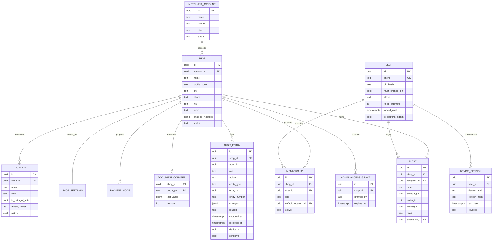

`SHOP_SETTINGS` reprend les attributs du CDC § 20.1 (format du reçu, pied de page, exemplaires, seuil de stock par défaut, prix minimum activé, délais). `ALERT.dedup_key` garantit l'envoi « une seule fois » (ex. `low_stock:<article>` tant que le stock n'est pas remonté, UC-STK-09).

### 5.3 Catalogue, stock, achats

```mermaid
erDiagram
    ARTICLE ||--o{ PRICE_HISTORY : historise
    ARTICLE ||--o{ STOCK_MOVEMENT : bouge
    LOCATION ||--o{ STOCK_MOVEMENT : concerne
    ARTICLE ||--o{ STOCK_LEVEL : projette
    LOCATION ||--o{ STOCK_LEVEL : projette
    INVENTORY ||--o{ INVENTORY_LINE : compte
    ADJUSTMENT }o--|| ARTICLE : corrige
    SUPPLIER ||--o{ PURCHASE : fournit
    PURCHASE ||--o{ PURCHASE_LINE : contient
    PURCHASE ||--o{ PURCHASE_FEE : supporte
    PURCHASE ||--o{ SUPPLIER_PAYMENT : réglé_par

    ARTICLE {
        uuid id PK
        uuid shop_id FK
        text display_name
        text brand
        text model
        text reference
        text stock_unit
        bool sellable_by_piece
        numeric piece_length_m
        bigint base_price
        bigint base_price_piece
        bigint min_price
        bigint min_price_piece
        numeric alert_threshold
        bigint last_cost
        bigint wac
        jsonb attributes
        text status
        int version
    }
    PRICE_HISTORY {
        uuid id PK
        uuid article_id FK
        text price_kind
        bigint old_price
        bigint new_price
        timestamptz effective_at
        uuid author_id
    }
    STOCK_MOVEMENT {
        uuid id PK
        uuid shop_id FK
        uuid article_id FK
        uuid location_id FK
        text type
        numeric quantity
        text condition
        text source_type
        uuid source_id
        bigint unit_cost
        numeric balance_after
        timestamptz occurred_at
    }
    STOCK_LEVEL {
        uuid article_id PK
        uuid location_id PK
        numeric sellable
        numeric damaged
        numeric incoming
        int version
    }
    INVENTORY {
        uuid id PK
        text number
        uuid location_id FK
        text status
        timestamptz started_at
        timestamptz validated_at
    }
    INVENTORY_LINE {
        uuid id PK
        uuid inventory_id FK
        uuid article_id FK
        numeric theoretical_qty
        numeric counted_qty
        text reason
    }
    ADJUSTMENT {
        uuid id PK
        uuid location_id FK
        uuid article_id FK
        text direction
        numeric quantity
        text condition
        text reason
        text note
    }
    SUPPLIER {
        uuid id PK
        uuid shop_id FK
        text name
        text phone
        text city
        text country
        bool active
    }
    PURCHASE {
        uuid id PK
        text number
        uuid supplier_id FK
        date purchase_date
        uuid location_id FK
        text invoice_ref
        text payment_status
        text status
    }
    PURCHASE_LINE {
        uuid id PK
        uuid purchase_id FK
        uuid article_id FK
        numeric entered_qty
        text entered_unit
        numeric stock_qty
        bigint unit_price
        bigint fee_share
        bigint final_unit_cost
    }
    PURCHASE_FEE {
        uuid id PK
        uuid purchase_id FK
        text kind
        text label
        bigint amount
    }
    SUPPLIER_PAYMENT {
        uuid id PK
        uuid purchase_id FK
        date paid_on
        bigint amount
        uuid mode_id FK
        text reference
    }
```

- Contraintes d'unicité : `(shop_id, brand, model)` pour le profil Motos, `(shop_id, reference)`, `(shop_id, number)` pour chaque document.
- `STOCK_LEVEL.incoming` est alimenté par les déplacements « En route » (Lot 2).
- **Costing (service de domaine)** : `allocate_fees(lignes, frais)` répartit au prorata de `qty × prix` ; le reste de l'arrondi entier va à la ligne de plus forte valeur, ce qui garde un total exact. `replay_wac(mouvements d'entrée triés par date)` recalcule le CMP après une correction ou une annulation (UC-ACH-03/04).

### 5.4 Ventes et créances

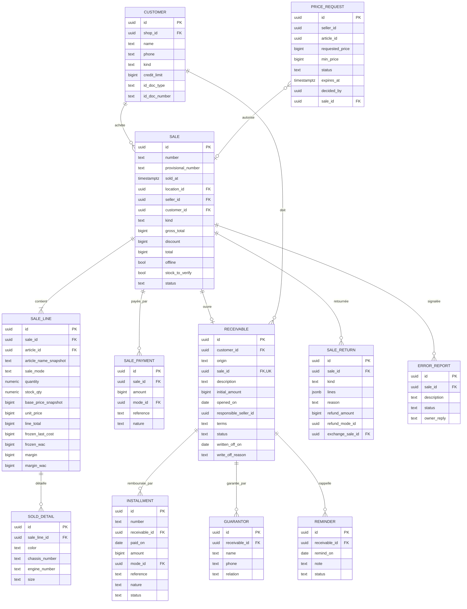

- Unicités : `(shop_id, phone)` sur `CUSTOMER` ; châssis unique parmi les ventes non annulées. Cette dernière règle (RG-M01) est vérifiée par le domaine via le port `SoldDetailRepository.find_active_chassis`, et non par un index partiel propre à PostgreSQL.
- `article_name_snapshot` conserve le nom du jour de la vente (UC-STK-02).
- `RECEIVABLE.total_paid` et `remaining` sont **calculés** par le domaine à partir des versements valides, jamais stockés seuls.

### 5.5 Dépenses, transferts, transport, import, pièces jointes

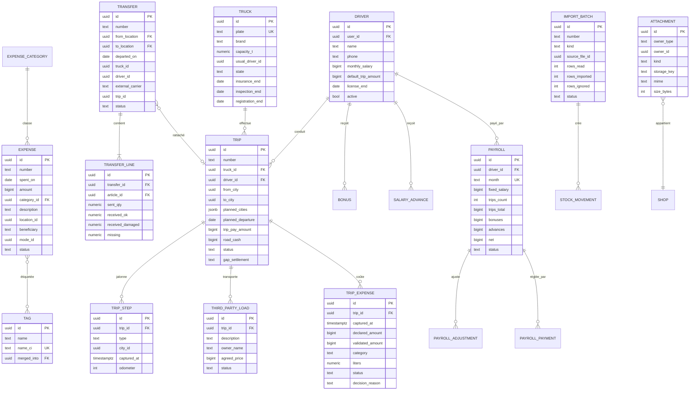

Les montants de `PAYROLL` sont figés au moment du paiement (paie verrouillée, UC-TRA-13). Le net est calculé par le service de domaine `Payroll.compute(...)` : salaire fixe + somme des voyages clôturés + primes − avances ± lignes exceptionnelles.

### 5.6 Migrations

- Alembic, dans l'adaptateur SQL uniquement ; une migration par changement, revue en PR, jamais éditée après fusion.
- Les données de départ d'un profil (lieux, catégories, modes de paiement, villes) sont créées par le cas d'utilisation `OpenShop`, **pas** par une migration : elles sont propres à chaque boutique.

## 6. API Design

### 6.1 Conventions

| Sujet | Règle |
| --- | --- |
| Base | `/api/v1` ; ressources de boutique sous `/api/v1/shops/{shop_id}/…` ; console admin sous `/api/v1/platform/…` |
| Format | JSON, `snake_case` ; montants en entiers ; quantités en chaînes décimales (`"2.5"`) pour éviter les flottants |
| Création | `POST` avec un `id` (UUIDv7) fourni par le client → **idempotent** (rejouer renvoie `200` et la même ressource) |
| Modification | `PATCH` + `version` (verrou optimiste) + `reason` si le CDC exige un motif ; `409 VERSION_CONFLICT` si l'objet a changé entre-temps |
| Annulation | `POST …/{id}/cancel` `{reason}` — aucune route `DELETE` métier |
| Pagination | par curseur : `?cursor=&limit=` → `{items, next_cursor}` |
| Filtres de période | `?from=YYYY-MM-DD&to=YYYY-MM-DD`, interprétés en journées `Africa/Douala` |
| En-têtes | `X-Device-Id` (obligatoire), `X-Captured-At` (heure de l'appareil) |
| Erreurs | `{"error": {"code": "STOCK_INSUFFICIENT", "message": "…", "details": {…}}}` |
| Contrat | OpenAPI exporté depuis FastAPI → types TS générés ; la CI échoue si le client n'est plus synchronisé |

### 6.2 Codes d'erreur (extrait)

| HTTP | Code | Cas |
| --- | --- | --- |
| 400 | `VALIDATION_ERROR` | champ manquant ou invalide (`details.fields`) |
| 401 | `UNAUTHENTICATED`, `SESSION_REVOKED` | jeton absent ou expiré, appareil déconnecté à distance |
| 403 | `FORBIDDEN` | permission absente (inscrit au journal) |
| 403 | `PIN_CHANGE_REQUIRED` | première connexion |
| 403 | `MODULE_DISABLED` | module de la route (ou de l'effet : crédit, versement, dépense) éteint pour la boutique (`details.module`, § 4.5) |
| 404 | `NOT_FOUND` | inexistant **ou appartenant à une autre boutique** (pas de fuite d'existence) |
| 409 | `VERSION_CONFLICT`, `DUPLICATE` | concurrence, unicité (téléphone, châssis, marque + modèle…) |
| 422 | `STOCK_INSUFFICIENT` | `details: {available, other_locations[]}` |
| 422 | `PRICE_BELOW_MINIMUM` | `details: {min_price, request_required: true}` |
| 422 | `CREDIT_LIMIT_EXCEEDED`, `OVERPAYMENT`, `DATE_OUT_OF_RANGE`, `INVALID_STATE_TRANSITION`, `PIN_TOO_SIMPLE` | règles métier |
| 422 | `MODULE_MANDATORY`, `MODULE_DEPENDENCY`, `MODULE_NOT_AVAILABLE` | combinaison de modules refusée (console plateforme, § 4.5) |
| 423 | `ACCOUNT_LOCKED` | `details: {until}` |

### 6.3 Catalogue des routes

| Contexte | Routes principales | Lot |
| --- | --- | --- |
| Auth | `POST /auth/login`, `POST /auth/refresh`, `POST /auth/logout`, `POST /auth/change-pin`, `GET /me` (boutiques + rôles) | 1 |
| Plateforme | `POST /platform/shops`, `GET /platform/shops`, `PATCH /platform/shops/{id}` (modules, statut) | 1 |
| Boutique | `GET /shops/{id}/profile`, `GET/PATCH /settings`, `GET/POST/PATCH /locations`, `GET/POST/PATCH /payment-modes`, `GET/POST /members`, `POST /members/{uid}/reset-pin`, `POST /members/{uid}/revoke-devices`, `POST /members/{uid}/unlock` | 1 |
| Catalogue | `GET/POST /articles`, `PATCH /articles/{id}`, `PUT /articles/{id}/prices`, `POST /articles/{id}/archive`, `GET /articles/{id}/movements` | 1 |
| Stock | `GET /stock` (matrice article × lieu), `GET /stock/value`, `GET /stock/damaged`, `POST /adjustments`, `POST /inventories`, `PUT /inventories/{id}/counts`, `POST /inventories/{id}/validate` | 1 |
| Achats | `GET/POST /suppliers`, `GET/POST /purchases`, `PATCH /purchases/{id}`, `POST /purchases/{id}/cancel`, `POST /purchases/{id}/payments` | 1 |
| Ventes | `GET/POST /sales`, `GET /sales/{id}`, `PATCH /sales/{id}`, `POST /sales/{id}/cancel`, `POST /sales/{id}/returns`, `POST /sales/{id}/error-reports`, `GET /sales/{id}/receipt` (DTO), `POST /price-requests`, `POST /price-requests/{id}/decision`, `GET/POST/PATCH /customers` | 1 |
| Créances | `GET /receivables`, `POST /receivables` (ancienne), `POST /receivables/{id}/installments`, `POST /installments/{id}/cancel`, `POST /receivables/{id}/write-off`, `POST /receivables/{id}/reminders`, `POST /receivables/{id}/guarantors`, `GET /customers/{id}/statement` | 1 |
| Dépenses | `GET/POST /expenses`, `PATCH /expenses/{id}`, `POST /expenses/{id}/cancel`, `GET/POST/PATCH /expense-categories`, `GET /tags`, `POST /tags/merge` | 1 |
| Reporting | `GET /dashboard?period=today|yesterday|week|month|last_month|custom`, `GET /dashboard/details/{metric}`, `GET /home` (accueil par rôle) | 1 |
| Alertes | `GET /alerts`, `POST /alerts/{id}/read` | 1 |
| Journal | `GET /audit`, `GET /audit/entities/{type}/{id}`, `GET /audit/users/{uid}` | 1 |
| Pièces jointes | `POST /attachments` (multipart), `GET /attachments/{id}/url` (URL signée après contrôle des droits) | 1 |
| Sync | `GET /offline-snapshot?since=`, `POST /sync` | 1 |
| Transferts | `GET/POST /transfers`, `POST /transfers/{id}/receptions`, `POST /transfers/{id}/cancel`, `POST /stock/damaged/{id}/restore` | 2 |
| Transport | `trucks`, `drivers`, `trips` (+ `/steps`, `/loads`, `/expenses`, `/close`, `/cancel`), `trip-expenses/{id}/decision`, `bonuses`, `advances`, `payrolls/{month}` (+ `/adjustments`, `/payments`), `trucks/{id}/report`, `fleet` | 2 |
| Import | `GET /imports/templates/{kind}`, `POST /imports/preview`, `POST /imports`, `POST /imports/{id}/cancel`, `GET /imports/{id}/errors.xlsx` | 3 |

### 6.4 Contrat clé — créer une vente

```http
POST /api/v1/shops/{shop_id}/sales
X-Device-Id: 3f2a…   X-Captured-At: 2026-11-10T13:32:05+01:00
```

```json
{
  "id": "0193a7c2-…",
  "location_id": "…",
  "sold_on": "2026-11-10",
  "kind": "credit",
  "customer": { "id": null, "name": "Moussa A.", "phone": "+237690000000", "kind": "individual" },
  "lines": [
    { "article_id": "…", "sale_mode": "unit", "quantity": "1", "unit_price": 780000,
      "details": [{ "color": "Rouge", "chassis_number": "LBX…" }] }
  ],
  "payments": [{ "mode_id": "…", "amount": 300000, "reference": null }],
  "credit": { "reminder_on": "2026-12-01", "terms": "100 000 par mois", "guarantor": null },
  "price_request_id": null,
  "note": null
}
```

Réponse `201` (présentateur **vendeur**) :

```json
{
  "id": "0193a7c2-…", "number": "V-000124", "status": "valid", "kind": "credit",
  "total": 780000, "paid": 300000, "remaining": 480000,
  "receivable": { "id": "…", "remaining": 480000 },
  "lines": [{ "article_name": "Haojue HJ125-8", "quantity": "1", "unit_price": 780000, "line_total": 780000 }],
  "warnings": []
}
```

Le présentateur **propriétaire** ajoute par ligne `frozen_last_cost`, `frozen_wac`, `margin`, `margin_wac`.

### 6.5 Synchronisation hors ligne

> **Statut V1 : ossature seulement, désactivée.** Le contrat, la file d'envoi et le traitement serveur sont codés et testés (configuration de test où le droit est activé). En production, le droit `offline_capture` est faux pour toutes les boutiques : `POST /sync` répond `403 FEATURE_DISABLED` et l'instantané hors ligne n'est pas téléchargé. Ce qui suit s'applique quand la fonction premium sera activée.

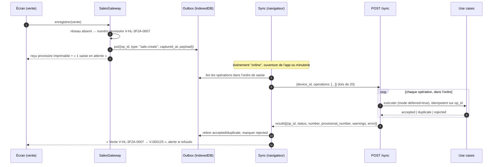

- **Opérations autorisées** (RG-T22) : `sale.create`, `expense.create`, `trip_expense.create`, `trip_step.create`, plus `customer.create` imbriqué dans une vente (fusionné par téléphone, UC-VEN-10).
- **Mode différé** : `RecordSale` avec `deferred=true` n'applique pas RG-T17 ; il marque `stock_to_verify` et émet `StockToVerify` (H13). Une vente sous le prix minimum par un vendeur est refusée côté client hors ligne (UC-VEN-03), et **aussi** au serveur si elle arrive quand même (`rejected` + alerte « saisie refusée »).
- **Résultat par opération** : une opération refusée ne bloque pas les suivantes ; elle reste visible sur l'appareil avec le motif.
- **Numéro provisoire** : `<préfixe>-HL-<4 derniers hex de device_id>-<séquence locale sur 4 chiffres>` (les derniers, aléatoires : les premiers chiffres d'un UUIDv7 sont l'horodatage et se ressembleraient d'un appareil à l'autre), stocké dans `provisional_number` et retrouvable par la recherche.
- **Instantané** `GET /offline-snapshot?since=` : articles actifs (sans coûts pour un vendeur), prix de base et minimum, lieux, modes de paiement, clients (ceux du vendeur), villes, voyage en cours (pour un chauffeur). Mis à jour à chaque connexion (RG-T25).
- **Déconnexion** (RG-T24) : bloquée par l'interface tant que la file n'est pas vide, sauf double confirmation ; l'abandon est rejoué au journal (`offline_ops_discarded`) à la reconnexion suivante.

## 7. State Management

### 7.1 Cycles de vie du domaine

Chaque transition est une méthode de l'agrégat ; toute transition non prévue lève `InvalidStateTransition`.

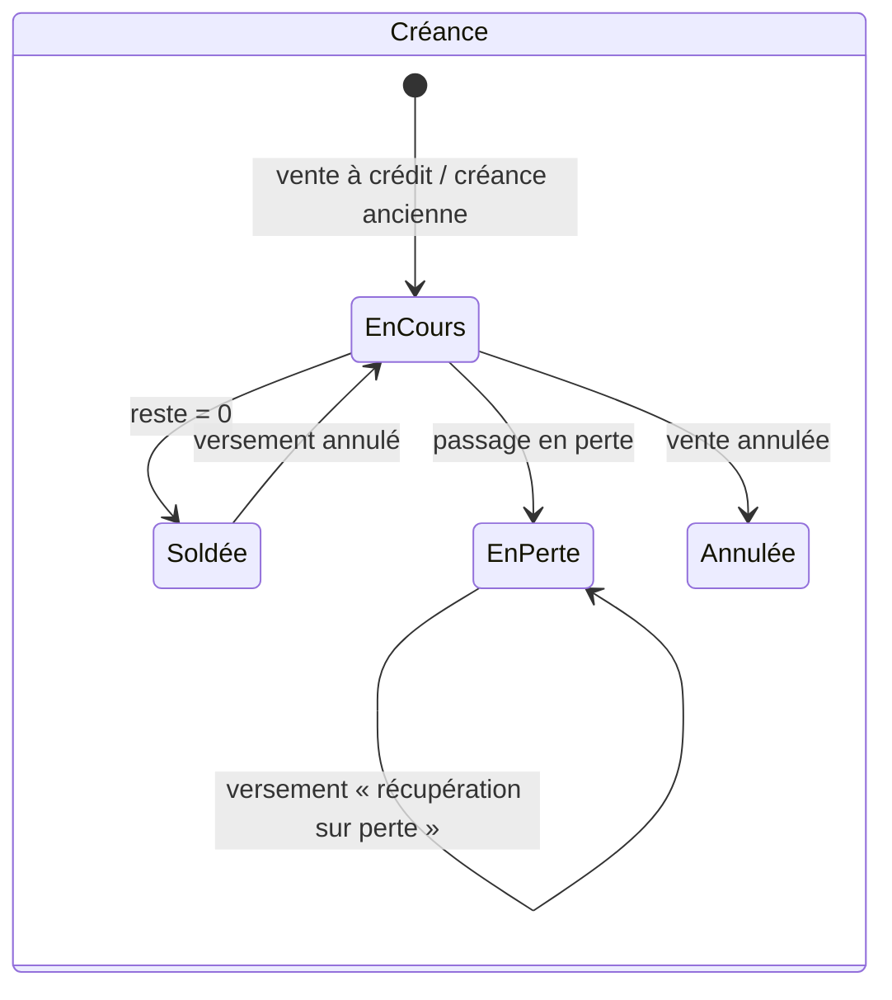

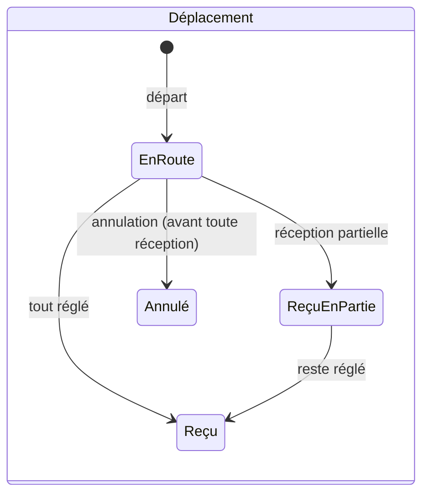

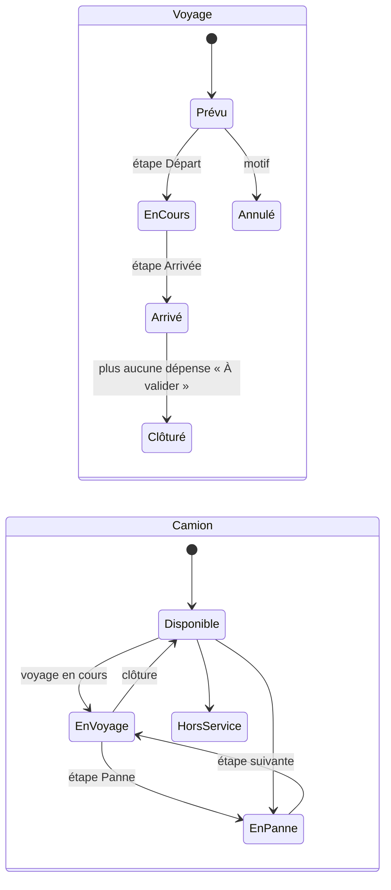

Autres machines à états, plus simples : Vente (`Valide → Annulée`), Demande de prix (`En attente → Acceptée | Refusée | Expirée`), Dépense de voyage (`À valider → Validée | Rejetée`), Paie (`À payer → Payée en partie → Payée`, verrouillée), Inventaire (`En cours → Validé | Abandonné`), Lot d'import (`Importé → Annulé`), Utilisateur (`Actif ⇄ Bloqué`, `Actif ⇄ Désactivé`).

### 7.2 État côté client

| Donnée | Où | Durée de vie |
| --- | --- | --- |
| Jeton d'accès | mémoire | 15 min, rafraîchi en tâche de fond (une seule requête à la fois) |
| Jeton de rafraîchissement | cookie httpOnly (`/api/v1/auth`) | lié à l'appareil, glissant, révocable |
| Boutique active | URL (`/s/{shopId}/…`) + mémoire | — |
| Données serveur | cache TanStack Query | invalidées après chaque mutation |
| Catalogue hors ligne, file d'envoi, compteur provisoire | IndexedDB (Dexie), espacé par `shop_id` | persistant, versionné (migration Dexie) |
| Dernier mode de paiement, lieu habituel | IndexedDB | préférences (CDC § 1.3) |

### 7.3 Politique de cache (décision du 11/11/2026)

| Ressource | Stratégie | Pourquoi |
| --- | --- | --- |
| Réponses de l'API (`/api/*`) | **jamais en cache** : `Cache-Control: no-store`, le service worker ne les intercepte pas | les chiffres sont toujours ceux du serveur (RG-T25) |
| Page d'entrée (`index.html`, manifest) | **réseau d'abord**, cache seulement si le réseau ne répond pas en 4 s | dès qu'il y a du réseau, on démarre sur la dernière version publiée |
| Fichiers JS/CSS/icônes | nom unique par version (empreinte dans le nom), cache d'abord | une mise à jour change les noms : un ancien fichier ne peut pas être servi à la place du nouveau |
| Toute entrée du cache | **expire au bout de 24 h** au plus | ne jamais dépendre longtemps du cache |

- Un bouton **« Recharger la dernière version »** (menu et Réglages) vide les caches, désinscrit le service worker et recharge tout depuis le serveur.
- Quand une nouvelle version est publiée pendant que l'application est ouverte, une bannière « Nouvelle version disponible — Mettre à jour » apparaît (vérification à l'ouverture puis toutes les 30 min).
- Le numéro de version est affiché dans Réglages et renvoyé par `GET /api/v1/health`, pour vérifier d'un coup d'œil que l'on est à jour.

**Mise à jour de l'application** (§ 21) : le service worker installe la nouvelle version en arrière-plan et l'active au lancement suivant. Le schéma IndexedDB est migré **sans vider** la file d'envoi ; un test E2E dédié le vérifie.

## 8. Security Model

### 8.1 Authentification

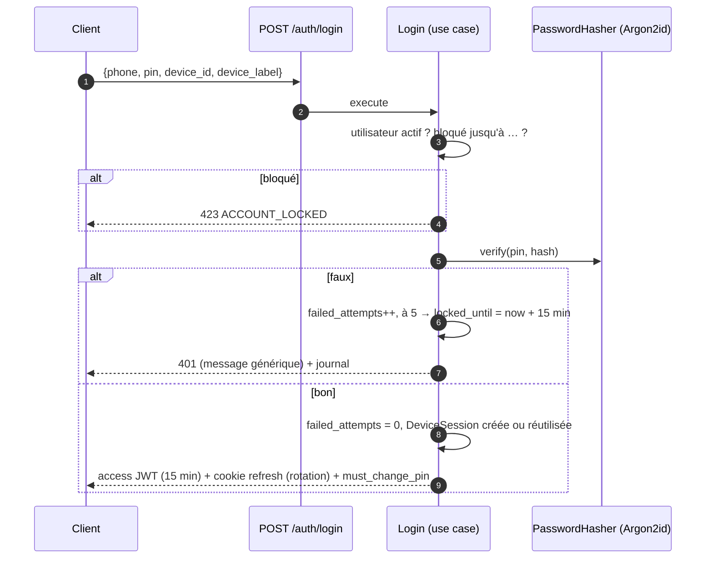

- Code : 6 chiffres. Refus des suites, des répétitions et d'une liste noire (RG UC-SOC-07). Hash Argon2id avec un sel par utilisateur.
- Limitation de débit par IP et par numéro sur `/auth/*`, en plus du blocage du compte.
- Rafraîchissement par rotation : réutiliser un jeton déjà tourné révoque la session de l'appareil.
- **Rejeu toléré d'une réponse perdue** (audit du 2026-11-13, § 15.1) : si la réponse d'un `POST /auth/refresh` se perd (réseau mobile, rechargements rapides, onglet fermé), le navigateur garde l'ancien cookie. Le jeton **tout juste remplacé** reste accepté pendant `REFRESH_REPLAY_GRACE` = **30 s** (`domain/identity/refresh_rotation.py`), **depuis le même appareil** (`X-Device-Id` de la session) : le serveur renvoie **le même successeur**, sans rien écrire, sans alerte (simple trace `INFO`). Pour cela le successeur est **déduit** du jeton présenté : `HMAC-SHA-256(clé de rotation, secret)`, clé dérivée de `JWT_SECRET` ; ni la base ni le jeton volé seuls ne permettent de le calculer, et aucun jeton en clair n'est stocké. La session garde l'empreinte du jeton remplacé (`previous_refresh_hash`) et l'instant de la rotation (`rotated_at`, migration 0016) ; la fenêtre part de la rotation et **ne glisse pas** avec les rejeux ; une nouvelle connexion l'efface.
- Hors de ces conditions, comportement inchangé : jeton remplacé présenté après 30 s, jeton plus ancien, ou jeton remplacé présenté par **un autre appareil** (preuve d'une copie du cookie) → révocation de la session (`REFRESH_REUSE`, journal sensible). Jeton courant présenté par un autre appareil → simple `401 UNAUTHENTICATED`, comme avant.
- Concurrence : deux rafraîchissements simultanés du même jeton calculent le même successeur ; le second se heurte au verrou optimiste, est rejoué sur l'état validé et devient un rejeu toléré (au plus 3 essais, puis l'erreur remonte). Côté client, un seul rafraîchissement à la fois par onglet (`singleFlight`, démarrage compris) ; un `401` sans l'enveloppe d'erreur de l'API (proxy, portail captif) n'est pas un refus de l'identité et ne déconnecte pas.
- `revoke-devices` (RG-D07) marque les sessions révoquées. Un compte désactivé (RG-D06) est refusé au login **et** au rafraîchissement.
- Le JWT d'accès contient `sub`, `sid` (session), `adm` (admin plateforme). Le rôle **n'est pas** dans le jeton : il est relu par boutique à chaque requête (`MEMBERSHIP`), si bien qu'un changement de rôle s'applique immédiatement.

### 8.2 Autorisation

- `Permission` est une énumération dans `application/security` (ex. `SALE_CREATE`, `SALE_READ_OWN`, `SALE_READ_ALL`, `COST_READ`, `STOCK_VALUE_READ`, `PRICE_SET`, `SALE_BELOW_MIN`, `TRIP_EXPENSE_VALIDATE`, `PAYROLL_MANAGE`, `AUDIT_READ`…).
- `role_matrix.py` traduit **littéralement** la matrice du CDC § 4.2. Un test paramétré vérifie chaque cellule de la matrice.
- Portée « Siens » : la politique ajoute un filtre `seller_id = actor.user_id` (ou `driver.user_id`) au niveau de la requête du dépôt, pas seulement à l'affichage.
- Masquage des champs (RG-D02 à D05) : les présentateurs de sortie choisissent le schéma selon `COST_READ` et `PRICE_READ`. Des tests de non-fuite vérifient qu'aucune réponse vendeur ne contient de clé `cost`, `wac`, `margin` ni `value`.
- Pièces d'identité : URL signée de 60 s, délivrée seulement au propriétaire et au vendeur responsable (UC-CRE-07).

### 8.3 Isolation des boutiques

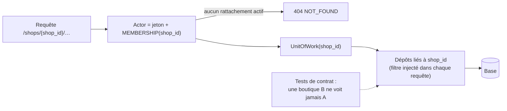

- La boutique est un paramètre **de construction** des dépôts : aucune méthode n'accepte un `shop_id` libre. On ne peut donc pas l'oublier.
- **Défense en profondeur facultative** (adaptateur PostgreSQL seulement) : RLS sur `shop_id` via `SET LOCAL app.shop_id`. Elle est activable par configuration, et la correction de l'application n'en dépend pas, conformément au principe de portabilité.
- Administrateur plateforme : il n'a pas de `MEMBERSHIP`. Il accède aux données d'une boutique seulement via un `ADMIN_ACCESS_GRANT` actif, créé par le propriétaire et limité dans le temps, et chaque accès est journalisé.

### 8.4 Données personnelles et transport

HTTPS partout (Caddy, Vercel) ; en-têtes de sécurité (HSTS, CSP stricte, `X-Content-Type-Options`). Pièces jointes dans un bucket privé, chiffrement au repos du volume et des sauvegardes. Aucun secret dans le dépôt : `.env` validé au démarrage. Journal en ajout seul : le rôle de base de données de l'API n'a pas le droit `UPDATE`/`DELETE` sur `audit_entry` (mesure d'adaptateur ; le port n'expose de toute façon que `append`).

## 9. Integration Points

| Intégration | Port | Adaptateur | Comportement en cas d'échec |
| --- | --- | --- | --- |
| Stockage de fichiers | `FileStorage` | MinIO (API S3) ; tout service S3 compatible | l'envoi échoue explicitement (`STORAGE_UNAVAILABLE`, 503) ; le client garde la photo et réessaie |
| Horloge | `Clock` | système, fuseau `Africa/Douala` | — |
| Hash des codes | `PasswordHasher` | argon2-cffi | — |
| Jetons | `TokenService` | JWT signé (HS256, secret ≥ 32 octets) | configuration invalide → arrêt au démarrage |
| Excel | `SpreadsheetReader/Writer` | openpyxl (Lot 3) | fichier illisible → `IMPORT_FILE_INVALID` avec le détail |
| Notifications téléphone | — | **aucune en V1** : alertes dans l'application seulement (cloche + liste, UC-SOC-09) | — |
| Impression | — (navigateur) | `window.print()` + CSS `@page` piloté par le profil d'impression de la boutique (§ 9.1) | repli : PDF partagé |
| Partage | — (navigateur) | Web Share API niveau 2 (fichiers) ; repli : téléchargement du PDF | — |
| Proxy Vercel | — | `vercel.json` : rewrite `/api/:path*` → `https://api.<domaine>/api/:path*` | si le VPS est indisponible, l'application affiche « Connexion nécessaire » (pas de file d'envoi en V1) |

### 9.1 Impression configurable

Le modèle d'imprimante est un **réglage du client** (UC-SOC-06), pas un choix figé dans le code. La boutique choisit un **profil d'impression** et peut l'ajuster : largeur du papier, largeur imprimable, marges, taille du texte, logo oui/non, nombre d'exemplaires. Trois profils sont fournis, chacun correspondant à un type d'imprimante courant :

| Profil | Type d'imprimante | Usage | Points d'attention |
| --- | --- | --- | --- |
| `thermal-58` | Thermique 58 mm portable, Bluetooth (type Xprinter XP-P300, Goojprt PT-210) | Prêt-à-porter, textile, vendeur mobile | Depuis Chrome Android, il faut un service d'impression Android (application du fabricant ou équivalent) ; largeur imprimable d'environ 48 mm |
| `thermal-80` | Thermique 80 mm de comptoir, USB, Bluetooth ou réseau (type Xprinter XP-Q80, XP-N160) | Boutique Motos (défaut, CDC § 17.1) | Largeur imprimable d'environ 72 mm ; coupe automatique |
| `a4-a5` | Imprimante bureautique laser ou jet d'encre | Ordinateur du propriétaire, bordereaux, fiches de paie | Gabarit A5 ou A4 standard |

Ces modèles sont des exemples de **types**, pas une liste fermée : tout matériel qui reçoit une impression du navigateur convient. Une page « Imprimer un reçu de test » permet au client de valider son réglage.

### 9.2 Sauvegardes

Une sauvegarde est une **copie complète des données** (base et photos), faite chaque nuit. Elle sert si le VPS tombe en panne, si le disque est perdu, si l'hébergeur a un incident ou si une erreur grave survient (piratage, mauvaise manipulation). Le CDC l'exige (§ 21 : copie quotidienne gardée 30 jours, restauration testée chaque mois ; conservation de 10 ans selon l'OHADA).

« Hors site » signifie que la copie est stockée **ailleurs que sur le VPS** : une copie qui reste sur le même serveur disparaît avec lui. Le conteneur `backup` chiffre chaque nuit `pg_dump` et les fichiers MinIO, puis les copie vers une **destination configurable** (port `BackupTarget` : dossier local ou stockage compatible S3).

**Mise en œuvre progressive (un seul VPS aujourd'hui) :**

| Étape | Destination | Protège contre | Ne protège pas contre |
| --- | --- | --- | --- |
| 1 — dès le Lot 1 | Volume dédié sur le VPS, 30 copies quotidiennes chiffrées, restauration testée chaque mois | erreur de manipulation, données corrompues, mauvaise mise à jour | perte ou panne du VPS, incident chez l'hébergeur |
| 2 — **avant d'avoir de vrais clients** | Stockage S3 externe à **offre gratuite** (Cloudflare R2 ou Backblaze B2, environ 10 Go gratuits), sans second VPS | perte totale du VPS | — |

Passer de l'étape 1 à l'étape 2 ne demande qu'un changement de configuration (`BACKUP_TARGET=s3`, identifiants), sans toucher au code.

## 10. Performance Considerations

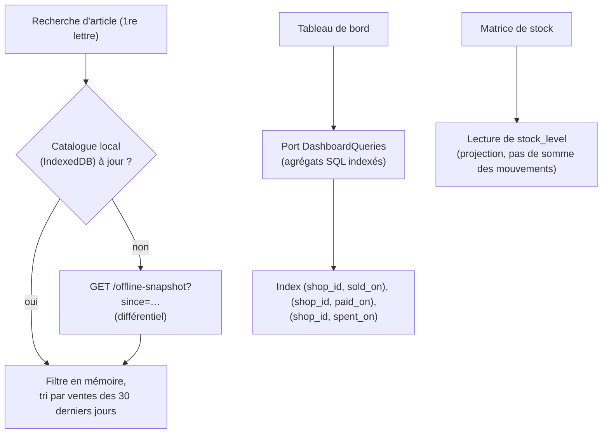

- **Budgets** : JS initial ≤ 250 Ko gzip ; première ouverture visée < 2 Mo, **plafond dur 3 Mo** qui fait échouer la CI ; mesurés en CI (`size-limit`) et par Lighthouse en profil 3G lent.
- **Classement « plus vendus »** : un compteur glissant est fourni dans l'instantané, ce qui évite tout calcul côté client.
- **Tableau de bord** : agrégats SQL sur des index de période, sans pré-calcul en Lot 1. Une table de résumés quotidiens ne sera ajoutée que si la mesure dépasse 300 ms au p95.
- **Contention de numérotation** : une ligne de compteur par boutique et par type ; transactions courtes et réessai automatique (3 fois) sur `VERSION_CONFLICT`. Volume visé : quelques centaines de documents par jour et par boutique.
- **Photos** : réduites côté client (≤ 1600 px, JPEG ~0,7) avant l'envoi.
- **Pagination par curseur** sur toutes les listes ; le journal est indexé `(shop_id, received_at DESC)`.

## 11. Technical Decisions

| # | Décision | Alternatives écartées | Pourquoi |
| --- | --- | --- | --- |
| D1 | Clean Architecture : ports et adaptateurs, composition root unique | MVC FastAPI + ORM partout | exigence de changer de base sans rien toucher d'autre ; domaine testable sans base |
| D2 | `import-linter` en CI pour la règle de dépendance | revue manuelle | une architecture non vérifiée finit par dériver |
| D3 | PostgreSQL + SQLAlchemy 2 (Core/ORM confiné à l'adaptateur), Alembic | SQLite ; MongoDB | concurrence, intégrité transactionnelle, conservation 10 ans ; SQLAlchemy facilite un futur adaptateur SQL |
| D4 | Isolation par dépôts liés à `shop_id`, RLS seulement en option | schéma par boutique ; base par boutique ; RLS obligatoire | portable sur toute base, opérations simples, testable par contrat |
| D5 | Identifiants UUIDv7 générés par l'application ou le client | séquences de la base | idempotence hors ligne, portabilité, tri temporel |
| D6 | Projection `stock_level` + journal des mouvements, verrou optimiste | stock calculé à chaque lecture ; `SELECT FOR UPDATE` | lecture rapide ; le verrou optimiste fonctionne sur toutes les bases |
| D7 | Événements de domaine traités dans la même transaction (journal, alertes) | journal écrit dans chaque route ; file de messages externe | traçabilité garantie (RG-T01) sans infrastructure supplémentaire |
| D8 | Ossature hors-ligne (file IndexedDB Dexie + `POST /sync` idempotent) livrée **désactivée** derrière le droit `offline_capture` | hors-ligne actif pour tous ; rien de prévu (à refaire plus tard) | fonction premium future (choix produit) ; les bases sont posées sans risque pour la V1 |
| D9 | Reçus rendus côté client (HTML + `@page`), PDF généré côté client et chargé à la demande | PDF côté serveur (WeasyPrint) | impression et partage doivent marcher hors ligne (UC-VEN-10) |
| D10 | Auth : JWT d'accès court + jeton de rafraîchissement par appareil en cookie httpOnly, à rotation | sessions serveur pures ; JWT long | révocation par appareil (RG-D07) et session longue sur téléphone (UC-SOC-02) |
| D11 | Frontend sur Vercel **et** VPS, avec proxy `/api` pour une origine unique | API appelée en cross-origin avec CORS | cookies first-party, aucun réglage CORS, même build aux deux endroits |
| D12 | Worker séparé (planificateur, tâches idempotentes) | cron du système hôte ; tâches dans l'API | redémarrages indépendants ; plusieurs workers API ne relancent pas les tâches en double |
| D13 | Profils de boutique comme configuration du domaine + `attributes` JSON validé par le domaine | une table par profil ; un code par version | « une version = des réglages » (CDC § 3.2) |
| D14 | React 18 + TS strict + Vite + Tailwind + TanStack Query + vite-plugin-pwa | Next.js ; application native | PWA légère, aucun SSR nécessaire, hébergeable en statique sur Vercel et Caddy |
| D15 | Caddy (TLS automatique) | Nginx + certbot | moins d'exploitation sur un VPS unique |
| D16 | Serveur de fichiers auto-hébergé compatible S3 derrière le port `FileStorage` : **Silo** (`pgsty/silo`, fork communautaire de MinIO, mêmes API et variables) | MinIO officiel (images retirées de Docker Hub, constat du 11/11/2026) ; Garage ; RustFS ; SeaweedFS ; disque local direct | remplacement direct de MinIO ; le port S3 permet de passer à Garage, RustFS ou un S3 managé par simple configuration ; sauvegardes simples |
| D17 | Port `Entitlements` (droits d'offre) lu depuis l'offre du compte, surchargeable par l'administrateur plateforme | drapeaux codés en dur ; service de feature flags externe | offres payantes prévues (CDC § 22) ; aucune dépendance externe |
| D18 | Pas de bibliothèque d'animation (Magic UI écarté) ; uniquement des transitions CSS | Magic UI, Framer Motion | minimalisme, budget de 3 Mo, téléphones d'entrée de gamme |
| D19 | Aucune notification sur le téléphone en V1 | Web Push | décision produit ; les alertes restent dans l'application |

Les versions exactes des dépendances seront **vérifiées sur la documentation officielle et verrouillées** (`uv.lock`, `package-lock.json`) au démarrage du Lot 1.

## 12. Validation

### 12.1 Stratégie de tests

| Niveau | Cible | Outils | Règle |
| --- | --- | --- | --- |
| Domaine | objets-valeurs, agrégats, Costing (prorata, CMP, rejeu), Payroll, transitions d'état | pytest (+ hypothesis pour les arrondis et le CMP) | aucun mock nécessaire : Python pur |
| Application | chaque UC, chaque permission, chaque événement → journal et alerte | pytest + adaptateurs mémoire | 1 UC = au moins 1 test de succès + 1 test par cas particulier du CDC |
| **Contrats de ports** | chaque dépôt, UnitOfWork, numérotation, isolation | **même suite** sur l'adaptateur mémoire **et** sur PostgreSQL (conteneur de test) | **c'est la preuve de la substituabilité de la base** |
| HTTP | schémas, codes d'erreur, présentateurs (non-fuite), idempotence | pytest + httpx | — |
| Architecture | règle de dépendance, taille des fichiers (≤ 200 lignes) | import-linter, script de CI | la CI échoue sinon |
| Frontend | formats (montants, dates), outbox, gateways, formulaires par profil | vitest + Testing Library | — |
| E2E | parcours clés, hors ligne (`context.setOffline`), mise à jour sans perte de file, accessibilité | Playwright (Chromium, viewport 360 px) + axe-core | — |
| Performance | budgets de taille et Lighthouse en 3G | size-limit, Lighthouse CI | — |

### 12.2 Critères d'acceptation (extraits du CDC)

| # | Critère | Vérification |
| --- | --- | --- |
| A1 | Vente comptant en 4 gestes et en moins de 30 s sur un téléphone de 360 px | E2E chronométré + test terrain |
| A2 | Le parcours CDC § 17.5 donne exactement : ventes 780 000, encaissé 300 000, marge 240 000, créance 480 000, coût unitaire 540 000 | test d'application de bout en bout (scénario de référence) |
| A3 | Exemple de CMP : 10 × 500 000 + 5 × 530 000 → 510 000 | test de domaine |
| A4 | Un vendeur ne reçoit aucun coût, CMP, marge ni valeur, sur aucune route | tests de non-fuite paramétrés sur toutes les routes |
| A5 | Une boutique B ne lit et ne modifie jamais les données de A | contrats de ports + tests HTTP croisés |
| A6 | Droit `offline_capture` inactif (production) : une coupure affiche « Connexion nécessaire », rien n'est mis en file, `/sync` renvoie `403 FEATURE_DISABLED`. Droit actif (test) : vente hors ligne → reçu provisoire → numéro définitif, alerte « stock à vérifier » si nécessaire | E2E dans les deux configurations |
| A7 | Toute action de la liste RG-T01 crée une entrée de journal ; aucune route ne la modifie | test par UC + absence de port d'écriture |
| A8 | Numéros continus et sans trou sous 20 ventes concurrentes | test de contrat de concurrence (PostgreSQL) |
| A9 | Le domaine et l'application passent toute leur suite avec l'adaptateur mémoire, **sans PostgreSQL** | job de CI dédié |
| A10 | Matrice des droits § 4.2 respectée cellule par cellule | test paramétré |

### 12.3 Commandes de vérification

```bash
cd backend
uv run ruff check . && uv run ruff format --check .
uv run mypy                                  # strict
uv run lint-imports                          # règle de dépendance
uv run pytest tests/domain tests/application # sans base
uv run pytest tests/contracts --backend=memory
uv run pytest tests/contracts --backend=postgres
uv run pytest --cov

cd ../frontend
npm run lint && npm run typecheck && npm run test:coverage
npm run check:api && npm run build && npm run size

cd ../e2e && npx playwright test
```

## 13. Risks & Mitigations

| Risque | Prob. | Impact | Atténuation |
| --- | --- | --- | --- |
| Des détails propres à PostgreSQL fuient hors de l'adaptateur (requêtes de reporting, JSONB, verrous) | Moyenne | Élevé | requêtes derrière des ports ; suite de contrats sur l'adaptateur mémoire ; pas de triggers ni de RLS obligatoires ; revue d'architecture à chaque PR |
| Conflits hors ligne (stock négatif, client en double, prix changé) — **seulement après activation premium** | Faible en V1 | Moyen | H13 (acceptation + alerte), fusion des clients par téléphone, prix figé à la saisie, résultat par opération visible |
| Perte de la file d'envoi (stockage vidé, mise à jour, téléphone perdu) — **seulement après activation premium** | Faible en V1 | Élevé | `navigator.storage.persist()`, migrations Dexie testées, blocage de la déconnexion (RG-T24), compteur visible |
| Impression thermique variable selon le modèle (Bluetooth / USB depuis Chrome Android) | Élevée | Moyen | profils d'impression configurables (§ 9.1), page de test d'impression, essais sur les 3 types proposés ; repli : PDF partagé |
| Rejeu du CMP après correction d'achat (dates antérieures, ventes intercalées) | Moyenne | Moyen | service de domaine pur, tests de propriétés (hypothesis), coûts des ventes figés et jamais recalculés |
| Contention sur la numérotation sans trou | Faible | Moyen | ligne de compteur par type, transactions courtes, réessai borné, test de charge |
| Limites du proxy Vercel (taille du corps, délai) pour les envois et l'import | Moyenne | Moyen | photos réduites côté client ; import ≤ 5 000 lignes ; vérifier les limites Vercel au Lot 1 ; repli : envois de fichiers directement vers `api.<domaine>` avec un jeton court |
| Réseau 3G lent pour le premier chargement | Moyenne | Moyen | budgets en CI (visé 2 Mo, plafond 3 Mo), découpage par route, précache par le service worker |
| En V1, sans hors-ligne, une coupure réseau empêche toute saisie | Élevée | Moyen | messages clairs (« Connexion nécessaire »), formulaire conservé à l'écran pour renvoyer en un appui, ossature prête pour l'activation premium |
| Plan Vercel **Hobby** réservé à un usage non commercial | Élevée | Moyen | passer au plan Pro avant la mise en production, ou ne servir que depuis le VPS (Q3) |
| Pérennité de Silo (fork communautaire de MinIO) | Moyenne | Moyen | dépendance confinée au port `FileStorage` ; tests de contrat S3 ; solution de repli identifiée : Garage ou RustFS |
| Endpoint Portainer exposé en HTTP sur une IP publique (jetons transmis en clair) | Moyenne | Élevé | mettre Portainer derrière HTTPS (Caddy) ou un VPN/tunnel, faire tourner le jeton et la clé API (Q10) |
| Code à 6 chiffres attaquable par force brute | Moyenne | Élevé | blocage 15 min / 5 essais, limitation par IP et par numéro, Argon2id, journal des échecs |
| VPS unique = point de défaillance unique ; tant que les sauvegardes restent sur le VPS (étape 1, § 9.2), sa perte fait perdre **toutes** les données | Moyenne | **Critique** | passer à l'étape 2 des sauvegardes (S3 gratuit hors site) avant les premiers vrais clients ; restauration testée chaque mois (TR-24) ; procédure de reconstruction scriptée |
| Périmètre très large | Élevée | Élevé | lots, micro-tâches, critères d'acceptation par lot, démonstration à la fin de chaque lot |
| Droit camerounais des données personnelles mal appliqué | Faible | Élevé | minimisation, accès par rôle, URL signées, chiffrement ; validation juridique (Q6) |

## 14. Découpage en lots

```mermaid
flowchart LR
    subgraph L1["Lot 1 — Cœur boutique Motos"]
        L1a["Socle, identité, console plateforme"]
        L1b["Catalogue, stock, inventaire, ajustements"]
        L1c["Achats + Costing"]
        L1d["Ventes, reçus, retours, demandes de prix, clients"]
        L1e["Créances, versements, rappels"]
        L1f["Dépenses"]
        L1g["Tableau de bord, accueils par rôle, alertes, journal"]
        L1h["PWA installable + ossature hors-ligne (désactivée)"]
    end
    subgraph L2["Lot 2 — Mouvement"]
        L2a["Transferts, stock abîmé"]
        L2b["Transport : camions, chauffeurs, voyages"]
        L2c["Étapes et dépenses de voyage<br/>(hors-ligne si premium)"]
        L2d["Primes, avances, paie, bilan camion"]
    end
    subgraph L3["Lot 3 — Extension"]
        L3a["Import Excel (7 modèles)"]
        L3b["Profil Prêt-à-porter (panier, remise, échange)"]
        L3c["Profil Textile (mètre, pièce, yard, chute)"]
    end
    L1 --> L2 --> L3
```

Chaque lot se termine par : tous les tests verts, critères d'acceptation du lot vérifiés, démonstration et mise en production sur le VPS et Vercel. Le découpage en micro-tâches par sous-agent (`@backend`, `@frontend`, `@qa`) se fera à l'étape 4.

## 15. Open Questions

### 15.1 Décisions prises (11/11/2026)

| Question | Décision |
| --- | --- |
| Q1 Imprimante | Configuration faite par le client ; 3 profils proposés (§ 9.1) |
| Q2 Notifications | Aucune notification sur le téléphone en V1 (D19) |
| Q5 Hors-ligne | Ossature seulement, désactivée ; future fonction premium (TR-26, D8, D17) |
| Q9 README | Réécrit pour ce projet |
| Q3 Domaine | Adresse par défaut `*.vercel.app` pour le frontend ; API sur `api.<ip>.sslip.io` en HTTPS ; vrai domaine plus tard |
| Q4 Sauvegardes | Étape 1 sur le VPS dès le Lot 1 ; étape 2 (S3 gratuit hors site) avant les premiers vrais clients (§ 9.2) |
| Poids | Visé < 2 Mo, plafond toléré 3 Mo |
| Magic UI | Écarté : minimalisme (D18) |
| Git / CI | Un commit par tâche validée ; dépôt GitHub privé ; CI GitHub Actions (lint, types, tests) à chaque push |
| Admin plateforme | Connexion par mot de passe fort (**10 caractères minimum**), et non par le code à 6 chiffres ; session de 8 h ; blocage après 5 essais |
| Q11 Vercel | Plan Hobby pendant le développement ; choix entre Pro et frontend servi par le VPS seulement avant les premiers clients |
| Q7 / Q8 | Délégation de l'admin : 24 h ; saisie refusée si elle est datée de plus de 10 min dans le futur (horloge du téléphone fausse) |
| Q-01 Réception des achats | Seul **Garoua** est un point de vente ; Garoua-Boulaï et Ngaoundéré sont des entrepôts. Le lieu de réception par défaut devient un **réglage de la boutique** : Garoua au Lot 1 (pas de déplacements avant le Lot 2), Garoua-Boulaï à partir du Lot 2 comme le prévoit le CDC § 17.1 |
| Q-02 Rejeu du CMP | Rejeu sur le **stock réel** au moment de chaque achat, ventes et sorties intermédiaires comprises (RG-T12) : 515 000 dans l'exemple de la recette |
| Q-09 Annulation | L'argent encaissé et les ventes sont retirés **le jour de l'annulation** ; les chiffres d'une journée passée ne changent jamais |
| Identité (T08) | Pendant un blocage, la réponse indique l'heure de fin (423) ; un code provisoire donné par le propriétaire lève aussi le blocage ; « déconnecter tous les appareils », débloquer et redonner un code agissent sur le compte entier (toutes ses boutiques) |
| Prix vu par le vendeur | Le vendeur voit le prix de base **et** le prix minimum ; il peut vendre sous le prix de base (négociation) |
| Sous le prix minimum | **Pas d'accord du propriétaire par défaut** (remplace H9 / UC-VEN-03) : avertissement à l'écran, vente acceptée, inscrite au journal comme action sensible. L'accord reste disponible par un réglage de boutique « Accord du propriétaire sous le prix minimum », désactivé par défaut |
| Échange | La nouvelle vente d'un échange peut être **à crédit** (client de la vente d'origine ; la différence devient une créance) |
| Nom d'article (prêt-à-porter, textile) | **Unique dans la boutique** (sans tenir compte des majuscules ni des accents), en plus de la référence |
| Dépense annulée | On garde : tableau de bord = retirée le jour de l'annulation ; liste des dépenses = hors annulées |
| Modules par boutique (2026-11-12) | **Seul l'administrateur plateforme** active ou désactive les modules d'une boutique (console). Toujours actifs : `core`, `audit`, `catalog`, `sales`. Facultatifs : `purchases`, `receivables`, `expenses`, `transfers`, `transport`, `dashboard`, `import`. Dépendances : `transport` ⇒ `transfers`. Un module désactivé : ses routes répondent `403 MODULE_DISABLED` (contrôle avant tout traitement, après le contrôle d'appartenance) et **tous** ses points d'entrée disparaissent de l'interface (menus, tuiles, boutons, cartes, alertes). Sans `receivables` : pas de vente à crédit, ni versement, ni garant, ni échange à crédit. Sans `expenses` : aucune dépense dans les chiffres. Les données déjà saisies sont gardées et réapparaissent à la réactivation |
| Page d'accueil (2026-11-12) | **Minimale** pour tous les rôles qui vendent : un grand bouton « Nouvelle vente », le total des ventes du jour (pour le vendeur : les siennes), puis les **5 dernières ventes** (vendeur : les siennes ; sans coût ni marge). Le tableau de bord complet du propriétaire devient un écran à part (appui sur « Ventes du jour », et entrée « Tableau de bord » dans « Plus »), seulement si le module `dashboard` est actif |
| Changer mon code | **Compteur d'essais séparé** de la connexion : 5 codes actuels faux ⇒ changement de code bloqué 15 min (`PIN_CHANGE_LOCKED`, 423) ; la session et la connexion restent utilisables ; un code provisoire du propriétaire lève ce blocage |
| Rafraîchissement perdu (audit du 2026-11-13) | Le jeton tout juste remplacé reste rejouable **30 s** (`REFRESH_REPLAY_GRACE`), depuis le **même appareil** seulement : le serveur renvoie le même successeur, sans révoquer ni alerter. Après 30 s, ou depuis un autre appareil : révocation et journal comme avant (§ 8.1) |
| Q-51 Rapidité et cache | < 2 s aux visites suivantes ; première visite la plus légère possible avec indicateur de progression ; politique de cache § 7.3 |

### 15.2 Questions ouvertes

1. **Q11 — Plan Vercel** : le plan Hobby n'autorise pas l'usage commercial. Passe-t-on au plan Pro avant les premiers vrais clients, ou sert-on alors le frontend seulement depuis le VPS ?
2. **Q4 bis — Stockage des sauvegardes** : avant les premiers vrais clients, choisir entre Cloudflare R2 et Backblaze B2 (offres gratuites).
3. **Q6 — Données personnelles** : faut-il une validation juridique de la conformité à la réglementation camerounaise (pièces d'identité, durée de conservation) ?
4. **Q7 — Accès de l'administrateur** : durée par défaut de la délégation `ADMIN_ACCESS_GRANT` (proposition : 24 h) ?
5. **Q8 — Horloge des appareils** : on rejette les saisies datées de plus de 10 min dans le futur (RG-T09) ; ce seuil convient-il ?
6. **Q10 — Portainer** : l'endpoint MCP est en HTTP sur une IP publique. Peut-on le placer derrière HTTPS (Caddy) ou un VPN, puis faire tourner le jeton ?
